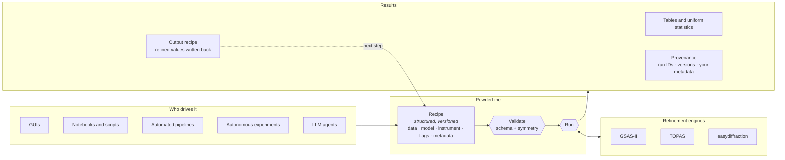

# PowderLine

**A complete powder diffraction refinement, as structured data that any
person, script or machine can write, check and run.**

[Documentation](https://nsls2.github.io/PowderLine/) ·
[Get started](https://nsls2.github.io/PowderLine/getting-started/) ·
[How it works](https://nsls2.github.io/PowderLine/concepts/how-powderline-works.html) ·
[Paper](https://doi.org/10.48550/arXiv.2608.17009)

## Why PowderLine

Rietveld refinement extracts structure, phase fractions and microstructure from
powder data. Doing it reliably takes expertise in a particular program, and
doing it at scale usually means custom code written for one project.

No refinement program offered a single, validated, machine-writable
description of a whole refinement. PowderLine provides one: the **recipe**.

## What it does



1. **Describe.** A recipe is a structured document holding the data, the
   structural model, the instrument, what to refine and any metadata you
   attach. In Python it is a dictionary. On disk or over the wire it is
   JSON. It can come from a file, a database record or a live data stream.
2. **Validate.** PowderLine checks the recipe against a versioned schema and
   against the crystallography: the cell against the space group, atoms on
   special positions, symmetry-tied parameters. No engine needs to be
   installed. Each problem is reported at its field, with the fix.
3. **Run.** PowderLine hands the recipe to the engine it names (GSAS-II,
   TOPAS or easydiffraction) and returns the same structured results whichever
   engine ran.
4. **Chain.** Every result includes an *output recipe*, with the refined
   values written back and provenance attached. That is the next step's
   input: calibrant → sample → temperature series.

## Why it matters

- **One interface for every driver.** A GUI, a notebook, a beamline pipeline,
  an autonomous experiment and an LLM agent all drive PowderLine the same
  way, with the same recipe, and get the same result.
- **Modular.** PowderLine sits between data and decisions. It takes data
  from your reduction step and hands structured results to whatever comes
  next: plotting, databases, decision-making for the next measurement.
- **Machine-checkable.** Validation names every problem and how to fix it, so
  a program or an LLM can write a recipe, check it and correct it without a
  person in the loop.
- **Traceable.** Your metadata (sample, measurement, data IDs) travels with
  the recipe into the results, and every run records what produced it. Data,
  analyses and their order stay linked.
- **Comparable.** Every engine reports Rwp, Rexp and GoF computed the same way
  over the same points.

## Try it

You need [pixi](https://pixi.sh) and git.

```bash
git clone https://github.com/NSLS2/PowderLine.git
cd PowderLine
pixi install --frozen -e gsasii
pixi run -e gsasii powderline examples/example_LaB6/input.json
```

The results are in `examples/example_LaB6/output/`.
[Your first refinement](https://nsls2.github.io/PowderLine/getting-started/first-refinement.html)
walks through them.

## Engines

| Engine | Workflows | Runs on |
|---|---|---|
| GSAS-II 5.7.9 | Rietveld, single-peak fitting | Linux, Windows, macOS |
| TOPAS 6 | Rietveld, single-peak fitting | Windows with a TOPAS licence (input files are written anywhere) |
| easydiffraction 0.21.1 | Rietveld | Linux, Windows, macOS |

## Cite

PowderLine is described in a paper accepted for publication in the *Journal
of Applied Crystallography*. Until it appears, please cite the preprint:

> A. A. Corrao, J. A. Perez, J. D. Langhout, M. M. Butala, T. A. Caswell, and
> D. Olds. *PowderLine: a programmatic powder diffraction analysis
> application.* arXiv:2608.17009 (2026).
> [doi:10.48550/arXiv.2608.17009](https://doi.org/10.48550/arXiv.2608.17009)

**Please cite the engine you used too:**

| Engine | Cite |
|---|---|
| GSAS-II | Toby & Von Dreele, *J. Appl. Cryst.* **46**, 544 (2013), [doi](https://doi.org/10.1107/S0021889813003531); O'Donnell et al., *J. Appl. Cryst.* **51**, 1244 (2018), [doi](https://doi.org/10.1107/S1600576718008075) |
| TOPAS | Coelho, *J. Appl. Cryst.* **51**, 210 (2018), [doi](https://doi.org/10.1107/S1600576718000183) |
| easydiffraction | easydiffraction 0.21.1, Zenodo (2026), [doi](https://doi.org/10.5281/zenodo.22905049), plus the calculator your recipe names (CrysPy or CrysFML) |

Full references, including the calculators and gemmi, are on
[Citing PowderLine](https://nsls2.github.io/PowderLine/about/citing.html).
Machine-readable metadata is in [`CITATION.cff`](CITATION.cff).

## Contributing and licence

See the [developer guide](https://nsls2.github.io/PowderLine/development/).
BSD 3-Clause licence, see [LICENSE](LICENSE).
