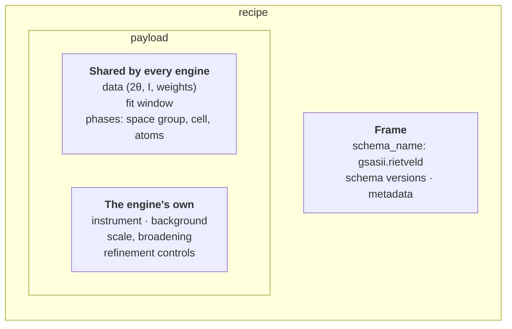
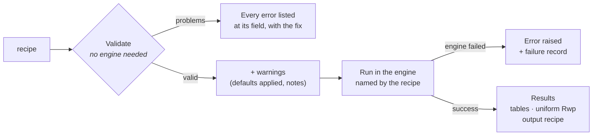
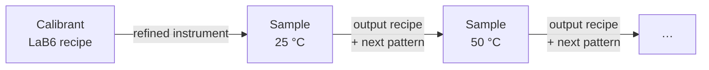
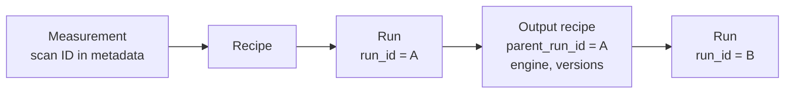
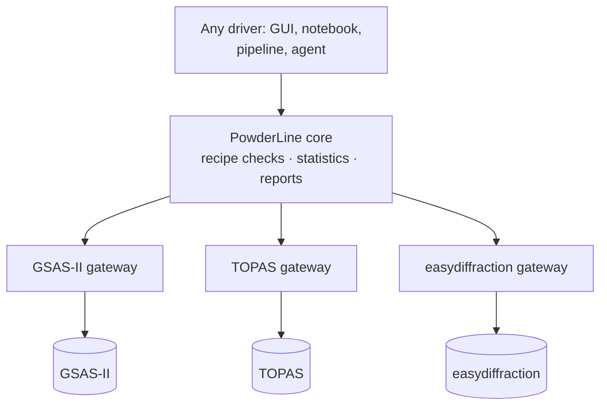

# How PowderLine works

In a GUI refinement program, the model lives in a project and a session. You
load data, set flags, refine, look and adjust. The steps you took are in your
head, or in a project file only that program can read.

PowderLine makes the whole refinement **structured data**. A recipe in gives
a result out, the same way every time and whoever (or whatever) supplied the
recipe. Five ideas make that work.

## 1. A recipe is the whole refinement, as structured data

A recipe is a nested dictionary with a fixed shape:



Because it is structured data, a recipe can be built by a script, stored in a
database, sent between services, filled from a live data stream, or written
by a GUI or an LLM. In Python it is a `dict`. When it is saved or sent it is
JSON. The data arrays are inside the recipe, so nothing depends on file paths.

### Every refinable number carries its flag

A refinable value is a short list: the value, then `true` to refine it or
`false` to hold it. Engines that accept limits take two more entries, a
minimum and a maximum (`null` for no limit):

::::{tab-set}
:sync-group: engine

:::{tab-item} GSAS-II
:sync: gsasii

```json
"a": [4.15682, true]
```
`[value, refine]`. GSAS-II recipes have no limits.
:::

:::{tab-item} TOPAS
:sync: topas

```json
"a": [4.15682, true, 4.10, 4.20]
```
`[value, refine, min, max]`.
:::

:::{tab-item} easydiffraction
:sync: easydiffraction

```json
"a": [4.15682, true, null, null]
```
`[value, refine, min, max]`; `null` means no limit.
:::
::::

Support differs per engine: GSAS-II takes no limits, and what a limit means
differs between TOPAS and easydiffraction (see
[Recipe format](../reference/recipe-format.md#bounds)).

→ More in [Recipes](recipes.md).

## 2. One recipe, one engine

The recipe's `schema_name` names the engine and the workflow, for example
`gsasii.rietveld` or `topas.spf`.

The instrument, background and controls are written in **that engine's own
terms and units**. GSAS-II's `U` is in centidegrees², TOPAS's is in degrees².
A GSAS-II recipe states GSAS-II's numbers.

PowderLine never translates between engines. Translating would mean guessing,
and guessing is how two programs end up refining two different models. The
structural part (space group, cell, atoms) is shared, so a structure
carries over from one engine's recipe to another's. [Recipe format](../reference/recipe-format.md)
says exactly what moves and what must be rewritten.

## 3. Check first, then run



**Validation** reads the recipe against a strict definition of what it may
contain (its *schema*). It also checks the crystallography: does the cell fit
the space group? Is each atom exactly on a special position, or clearly off
it? Is every parameter tied by symmetry stated, with the same flag?

Validation **never changes your recipe quietly**. Suppose an engine would
silently alter something: snap a coordinate, raise a value to a floor, or
misread a space-group setting. PowderLine then refuses the recipe and tells
you what to write instead.

Validation needs no engine installed. A recipe can be checked in a web
service, a notebook or a pipeline before it goes to the machine that runs it.
Because every error names its field and its fix, a program or an LLM can
correct its own recipe.

:::{important}
Validation checks that a recipe is **well-formed and consistent with its
symmetry**. It does not judge whether your refinement choices are sensible.
See [Good refinement practice](refinement-practice.md).
:::

→ More in [Validation](validation.md).

## 4. Results you can compare and chain

Every engine returns the same things:

- **The same tables**: refined parameters with uncertainties, unit cell,
  reflection list, the fitted profile.
- **The same statistics**: PowderLine computes Rwp, Rexp and GoF itself, over
  the same data points, whichever engine ran. The engine's own values are
  kept alongside.
- **An output recipe**: your recipe with the refined values written back. It
  is a valid recipe, ready to run again.

Results come back as Python objects (tables as DataFrames), and are also
written as files.

The output recipe makes automation simple: each step's result is the next
step's input.



→ More in [Results](results.md) and
[Run a series](../how-to/sequential-refinement.md).

## 5. Metadata and provenance travel with the analysis

A recipe can carry a free-form `metadata` block: a sample ID, a scan ID, the
data's location in your catalogue, how the recipe was generated. PowderLine
never reads it, but carries it through.

Every run gets its own ID. The output recipe records which run produced it,
which engine and version ran, and which PowderLine version. It records only
that one run, so to trace a whole chain of analyses, keep each step's input
recipe and result together.



→ More in [Results](results.md#provenance).

## Where the engines fit

PowderLine contains no refinement code. Each engine is reached through a
**gateway**: a small adapter that knows that engine's recipe format, how to
drive it and how to read its output.



You install only the engines you use. Adding a fourth engine means writing a
fourth gateway; nothing else changes. See
[Architecture](../development/architecture.md).

## Further reading

- The PowderLine [preprint](https://doi.org/10.48550/arXiv.2608.17009)
  describes the design and its motivation.
- [Comparing engines](comparing-engines.md) refines the same data in every
  engine and explains why the numbers differ.
