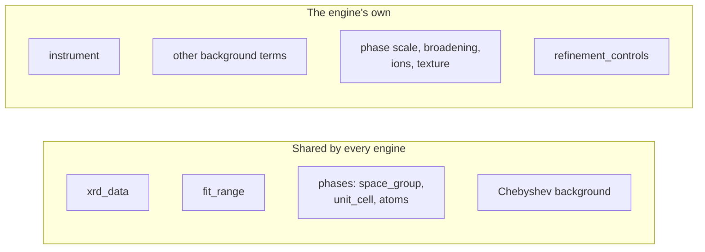

# Recipes

A **recipe** is a complete description of one refinement as structured data:
the measured pattern, the structural model, the instrument, what to refine,
and anything you want to record alongside. PowderLine reads nothing else.

## Structured data, not a program's project file

A recipe is a nested dictionary with a fixed, documented shape. In Python
it is a `dict`. When it is stored or sent it is JSON.

That makes a recipe easy to produce and to move:

- a script or notebook can build one from your reduced data and a CIF;
- a database or catalog can store one next to the measurement it analyzes;
- a pipeline can fill one from a live data stream and pass it on;
- a GUI or an LLM assistant can write one, and validation tells it what to fix.

The data arrays are inside the recipe, so a recipe never depends on file
paths. Load one from disk with `powderline.load_recipe_asset(path)`, or pass
a dictionary you built to `powderline.run()` and `powderline.validate()`
directly.

## Anatomy

```json
{
  "schema_name": "gsasii.rietveld",
  "core_schema_version": "0.1.0",
  "engine_schema_version": "0.1.0",
  "metadata": {"sample": "LaB6 SRM 660c", "scan_id": "..."},
  "payload": {
    "xrd_data": {"tth": ["..."], "Itth": ["..."], "Itth_weights": ["..."]},
    "fit_range": [1.0, 15.0],
    "instrument": {"...": "..."},
    "background": {"chebyshev": {"...": "..."}},
    "phases": {"LaB6": {"space_group": "P m -3 m", "unit_cell": {"...": "..."},
                        "atoms": {"...": "..."}, "scale": [1.0, true]}},
    "refinement_controls": {"refinement_cycles": 5}
  }
}
```

| Part | What it is |
|---|---|
| `schema_name` | The engine and the workflow, `<engine>.<workflow>`: `gsasii.rietveld`, `gsasii.spf`, `topas.rietveld`, `topas.spf` or `easydiffraction.rietveld` |
| `core_schema_version`, `engine_schema_version` | The versions of the shared and the engine-specific rules the recipe follows. See [Versions](../reference/versions.md) |
| `metadata` | Anything you want to keep with the recipe. PowderLine never reads it, and carries it into the results |
| `payload` | The refinement itself |

Inside `payload`, some blocks are **shared by every engine** and some are
**the engine's own**:



The shared blocks mean the same thing everywhere, so a structure written
for one engine carries over to another. Its parameters gain or lose the two
limit entries (see below), and the engine's own phase fields are rewritten.
[Recipe format](../reference/recipe-format.md) gives the exact rule.

## Every refinable value carries its flag

A value that can be refined is a short list: the value, then `true` to refine
it or `false` to hold it. Engines that accept limits take a minimum and a
maximum as well, with `null` for no limit:

::::{tab-set}
:sync-group: engine

:::{tab-item} GSAS-II
:sync: gsasii
```json
"a": [4.15682, true]
```
`[value, refine]`. GSAS-II recipes have no limits.
:::

:::{tab-item} TOPAS
:sync: topas
```json
"a": [4.15682, true, 4.10, 4.20]
```
`[value, refine, min, max]`.
:::

:::{tab-item} easydiffraction
:sync: easydiffraction
```json
"a": [4.15682, true, null, null]
```
`[value, refine, min, max]`.
:::
::::

What a limit means differs between engines. See
[Recipe format](../reference/recipe-format.md#bounds).

## One recipe, one engine

The instrument, background and controls are written in **the engine's own
terms and units**. GSAS-II describes peak widths with `U, V, W` in
centidegrees²; TOPAS and easydiffraction use degrees², and some letters swap
roles. A GSAS-II recipe states GSAS-II's numbers.

PowderLine never converts a recipe from one engine to another. A converted
instrument would be a guess, and two engines running two guesses would be
refining two different models. To use another engine, write its recipe, or
calibrate its instrument again on your standard.

## Where recipes come from

PowderLine defines the recipe precisely and checks it strictly. It doesn't
build recipes for you and has no CIF reader. That is deliberate:

- Recipes are built in many ways: by hand, by a script, from a structure
  database, from a GUI or with an LLM assistant. A built-in builder would make
  choices (defaults, file formats, a first refinement strategy) that suit
  some of these and get in the way of others.
- A CIF reader would have to guess where a CIF is ambiguous: a space-group
  symbol without its origin choice, or a coordinate rounded to `0.3333` on a
  special position. Guessing silently is exactly what validation refuses.

So the tool that knows where your data came from does the conversion, and
PowderLine checks the result. [Analyze your own data](../getting-started/your-own-data.md)
shows the steps. The `examples/` folder has complete recipes for every
engine, and `examples/example_template/` has blank skeletons.

## Every field

[Fields](../reference/fields.md) lists every field of every recipe type, with
its unit, generated from the code. [Recipe format](../reference/recipe-format.md)
gives the rules shared by all of them.
