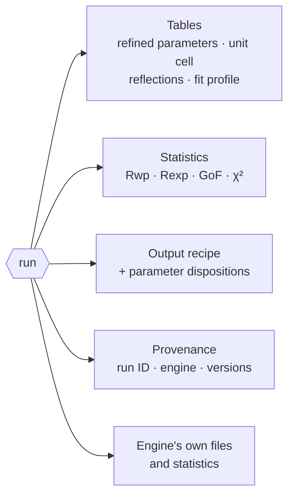
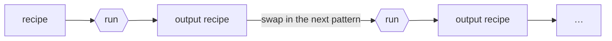
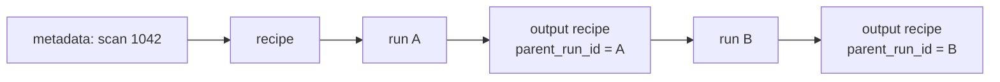

# Results

Every engine returns the same kind of result: the same tables, the same
statistics, a recipe you can run next, and a record of how it was made.
[Outputs](../reference/outputs.md) lists every key and file; this page
explains what they mean.

## What comes back

From Python, `powderline.run()` returns a dictionary with the tables as
pandas DataFrames. The same tables are written as files with fixed names, so
a script finds them without asking which engine ran.

## The same statistics for every engine

PowderLine computes Rwp, Rexp, the goodness of fit and reduced χ² itself,
with one formula, over the points inside the fit window that have a positive
weight:

$$R_{wp} = 100 \sqrt{\frac{\sum_i w_i (y_{obs,i} - y_{calc,i})^2}{\sum_i w_i y_{obs,i}^2}}, \qquad
R_{exp} = 100 \sqrt{\frac{N - P}{\sum_i w_i y_{obs,i}^2}}, \qquad
\mathrm{GoF} = \frac{R_{wp}}{R_{exp}}, \qquad \chi^2_{red} = \mathrm{GoF}^2$$

N is the number of points used and P the number of parameters the engine
varied.

Why compute them again? The engines define them differently. They count
different points, cap values at 100 %, or use one name for two quantities.
With one formula over the same points, two models of the same data can be
compared directly. The engine's own values are kept in `engine_details`.

:::{note}
A lower Rwp means *this model* fits *these points* better. It doesn't mean one
engine is better than another. [Comparing engines](comparing-engines.md) shows
why.
:::

## Did the engine do what you asked?

Two counts in `engine_details` show it:

- `parameters_requested`: the independent parameters your recipe asks to
  refine, with each symmetry-tied group counted once;
- `parameters_varied`: what the engine actually varied.

Engines quietly drop or merge parameters, so when fewer are varied than
requested you get a warning. `converged` says whether the engine reached its
convergence criterion: `true`, `false`, or `null` when the engine can't tell
(TOPAS) or nothing was refined.

## The output recipe

Every result includes an **output recipe**: your recipe with the refined
values written back, symmetry-derived values in their exact form, and any
defaults stated. Your flags, bounds, controls and data are unchanged. It is a
complete recipe of the same type, ready to run again.

That is what makes chaining simple: calibrant to sample, or one pattern of a
series to the next. See [Run a series](../how-to/sequential-refinement.md).

`output_recipe_valid` says whether the output recipe passes validation as
written. It fails when the engine returned a value the schema refuses, such as
a negative crystallite size or an occupancy above 1. The recipe is still
returned and written so you can see what the engine produced, and the
warning `output_recipe_not_valid` names the value. A chained next step should
stop there.

### Parameter dispositions

`parameter_dispositions` lists every refinable value by its place in the
recipe, with the refined value, its ESD, and what happened to it:

| Disposition | Meaning |
|---|---|
| `varied` | refined by the engine |
| `held_by_user` | its flag was `false` |
| `held_by_symmetry` | fixed by the space group |
| `requested_not_varied` | its flag was `true`, but the engine did not vary it |
| `default_applied` | not in your recipe; PowderLine applied a documented default |

A column `at_limit` marks values that ended on a bound.

## Provenance

A recipe's `metadata` block is yours: sample IDs, scan IDs, where the data
live in your catalogue, how the recipe was made. PowderLine never reads it and
carries it through to the output recipe.

PowderLine adds one entry of its own, `metadata.powderline_provenance`, to
every output recipe:

| Key | What |
|---|---|
| `parent_run_id` | the ID of the run that produced this recipe (the result's `run_id`) |
| `schema_name` | the recipe type |
| `engine`, `engine_version` | the engine and the version that ran |
| `powderline_version` | the PowderLine version |
| `created` | when, in UTC |

Each run has a unique `run_id`. Follow the `parent_run_id` links and a chain
of analyses leads back, step by step, to the recipe and the data it started
from.

## When a run fails

A failed run never returns a result. It raises one of two errors:

| Error | Meaning | Example |
|---|---|---|
| `EngineExecutionError` | The engine ran and failed | The refinement diverged |
| `ExecutionBackendError` | The engine never ran | The GSAS-II server could not start |

Both carry `.reason`, a short code, and `.result`, the full failure record.
The output folder then holds the engine's own files and `failure.json`, the
same record with its provenance, and no result tables. A table that exists
always comes from a run that succeeded.

## Simulations

A run that refines nothing is a **simulation**: it calculates the pattern of
the recipe as written. The result says `simulation_mode: true`. The statistics
are computed in the same way, so against real data they show how good your
starting values are. See [Simulate a pattern](../how-to/simulate.md).
