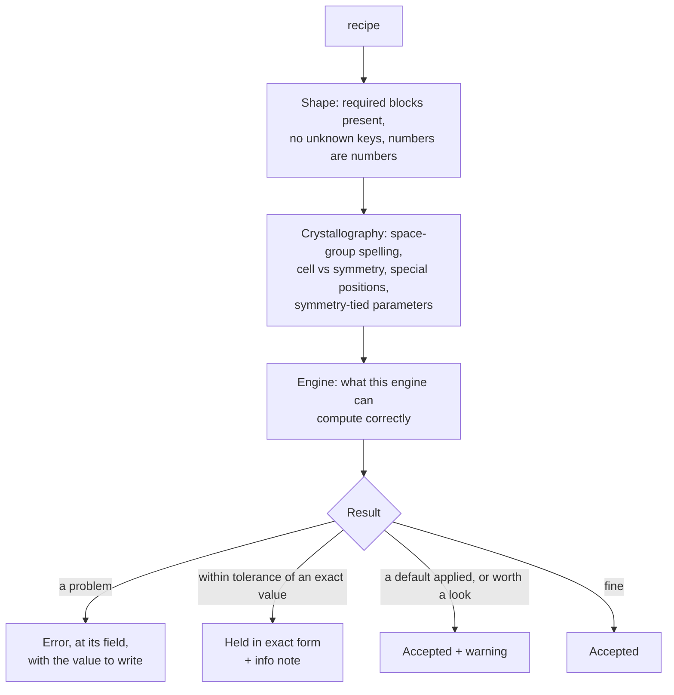

# Validation

Before any engine runs, PowderLine checks the recipe. Validation answers one
question: **is this recipe well formed, and does it mean exactly one thing,
the same thing in every engine?**

## What is checked



- **Shape.** Every required block is there, nothing unknown is present
  (`radiaton` is an error, not ignored), numbers are JSON numbers, and flags
  are `true` or `false`.
- **Crystallography.** The space group is spelled in its one exact form, the
  cell fits the space group, atoms sit exactly on special positions or
  clearly off them, and parameters tied by symmetry are stated together.
- **The engine.** Settings or values the chosen engine would misread or
  silently change are refused for that engine. The [Engines](../engines/index.md)
  pages list them.

Validation needs no engine installed. It runs in the default environment, and
from Python with `powderline.validate(recipe)`.

## Errors, warnings and notes

| You see | It means | You do |
|---|---|---|
| **Error** | The recipe is ambiguous, inconsistent or something the engine would get wrong | Fix it. The message names the field and, where it can, the value to write |
| **Warning** | Accepted, but PowderLine applied a documented default, or something deserves a look | Read it; state the value yourself to silence a default |
| **Info note** | A record of something PowderLine did that changes nothing you meant | Nothing |

Every problem is reported at once, so you can fix them in one pass. Some
checks wait until earlier ones pass: the cell is checked against the space
group only once the space group is valid. [Messages](../reference/messages.md)
lists every warning.

## Never silently

PowderLine's rule: **validation never changes what a recipe means, and never
quietly.**

Refinement programs routinely adjust input behind your back. One snaps an
atom onto a special position within its own tolerance; another reads a
space-group symbol in a different origin choice; another raises a value to
an internal floor. Each is reasonable on its own. But the same recipe then
means different things in different programs, and nothing tells you.

PowderLine refuses those cases instead, and tells you what to write. Where a
value is within tolerance of its exact symmetry-derived form, PowderLine holds
the exact form and records an info note (`symmetry_value_derived`) with both
values.

## Space groups: one spelling per setting

`space_group` must be gemmi's canonical extended Hermann–Mauguin name:
`"P m -3 m"`, `"C 1 2/m 1"`, `"P 1 21/c 1"`, `"R -3 m:H"`, `"F d -3 m:2"`.

The spelling states the **setting**: `:1`/`:2` for the groups with two origin
choices, `:H`/`:R` for rhombohedral groups, the full symbol for the
monoclinic unique axis and cell choice.

Why so strict? Coordinates differ between settings. A lenient lookup picks a
setting for you, and programs pick differently: `"Fd-3m"` means origin 1 in
one and origin 2 in another. A recipe that doesn't state its setting could
run on a different structure in different engines.

Any other spelling is an error that gives the canonical name. A symbol
without a setting (`"F d -3 m"`) lists the choices. A short monoclinic
symbol (`"C2/m"`) lists every setting by unique axis.

Each engine then refuses the settings it can't express or reads wrongly.
To use such a setting, transform the structure to a standard one.

## Unit cell

All six values are stated in every space group. Tied lengths and angles must
equal the first one (cubic `b = a`, `c = a`), and fixed angles must be exactly
90° (or 120° for `gamma` on hexagonal axes), within 1e-9. A cell that doesn't
fit is an error stating the value to write:

```text
unit cell is inconsistent with 'P m -3 m' (cubic): stated b = 4.2,
but by symmetry b = a; write b = 4.15682
```

## Special positions

An atom is either **on** a special position or clearly **off** it:

| Distance from the special position (fractional) | PowderLine reads it as |
|---|---|
| exactly on it, or within 5e-6 | on it; values derived by symmetry are held exactly |
| between 5e-6 and 2e-3 | **error**: state the position exactly, or move the atom at least 2e-3 off |
| 2e-3 or more | a general position, used as stated |

On a special position:

- the **first member** of each tie group (x before y before z; U11 before
  U22 …) is free and kept exactly as written;
- a **constant** of the site is written exactly when it has a decimal form
  (`0.5`, `0.25`, `0`), and to at least six decimals when it doesn't
  (`0.333333` for 1/3);
- a value **derived from another** (`y = 2x`, `U22 = U11`) is stated to six
  decimals (coordinates) or within 1e-6 Ų (Uij) and read as the derived value.

| You write | Symmetry | PowderLine holds | Why |
|---|---|---|---|
| `x = 0.4999999` at (1/2, 0, 0) | x = 1/2 | **error**: write `x = 0.5` | 1/2 has an exact decimal form |
| `x, y = 0.333333, 0.666667` at (1/3, 2/3, 1/4) | fixed thirds | 1/3, 2/3 | six decimals state a third |
| `x, y = 0.1, 0.2000001` at (x, 2x, 0) | y = 2x | 0.1, 0.2 | y follows x |
| `U13 = 1e-9` on a site where U13 = 0 | U13 = 0 | **error**: write `U13 = 0.0` | 0 is exact |

Most crystallographic programs instead move any atom within a distance
tolerance onto the special position, and each uses a different tolerance.
The engines PowderLine drives disagree too. Deciding once, in PowderLine,
means every engine reads the same structure. For atoms placed just off a
special position on purpose, see
[Model disorder near special positions](../how-to/disorder.md).

## Symmetry-tied parameters

Parameters tied by symmetry are **one** parameter, and every member is
stated:

- tied members carry the **same refine flag** (cubic `a`, `b`, `c` all `true`
  or all `false`);
- a parameter **fixed** by symmetry (a cubic angle, `x` of an atom at the
  origin) has flag `false`, and no bounds where the engine has them;
- where the engine has bounds, tied members' bounds follow the tie like their
  values;
- atoms at the same position are independent: PowderLine never ties them.

## Elements, occupancies, displacement parameters

- `element` is the bare, neutral symbol, spelled exactly (`"Fe"`). Ions go in
  the engine's `scattering_types` block (`"La3+"`); see
  [Engines](../engines/index.md).
- `occupancy` is required and lies between 0 and 1.
- `ADP` chooses `Uiso` or all six `Uij` (Ų), which follow the site symmetry
  by the same rules as coordinates. A `Uaniso` that isn't positive definite,
  or a negative `Uiso`, is accepted with a warning: it can be a sign that the
  parameter is absorbing something the model lacks.

## Validation is not judgement

Passing validation means the recipe is **well formed and consistent with its
symmetry**. It doesn't mean it is the model you intended, or that your data
can support what you chose to refine.

:::{important}
PowderLine doesn't arbitrate your refinement choices. See
[Good refinement practice](refinement-practice.md).
:::
