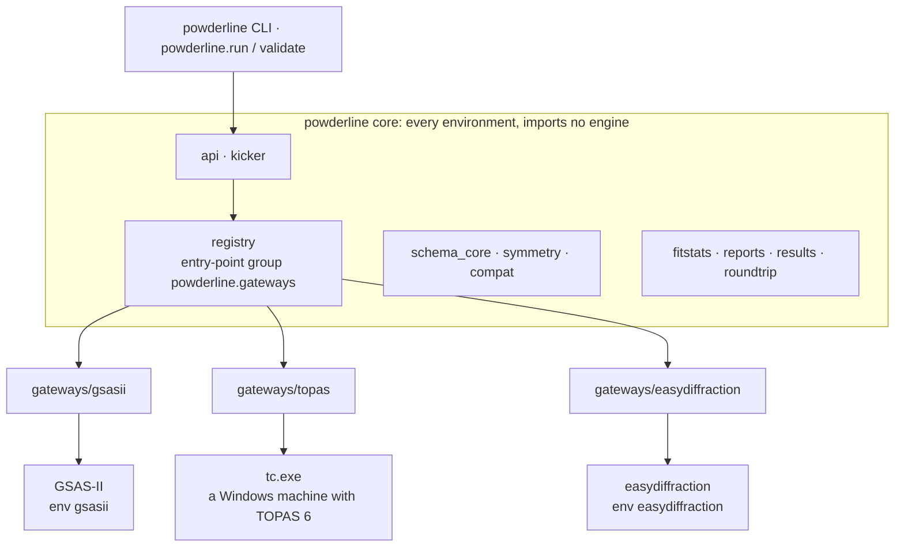
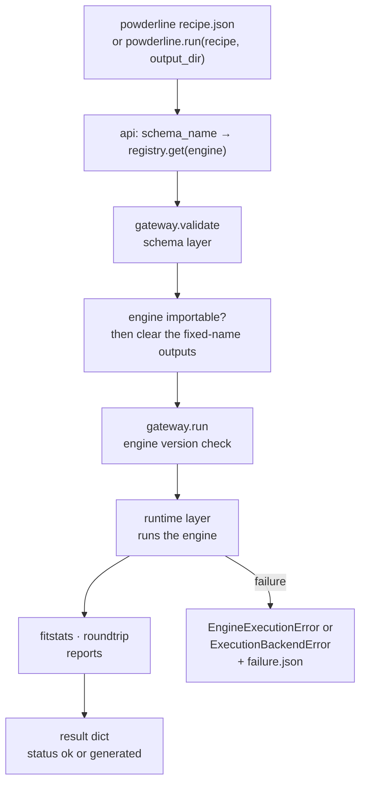
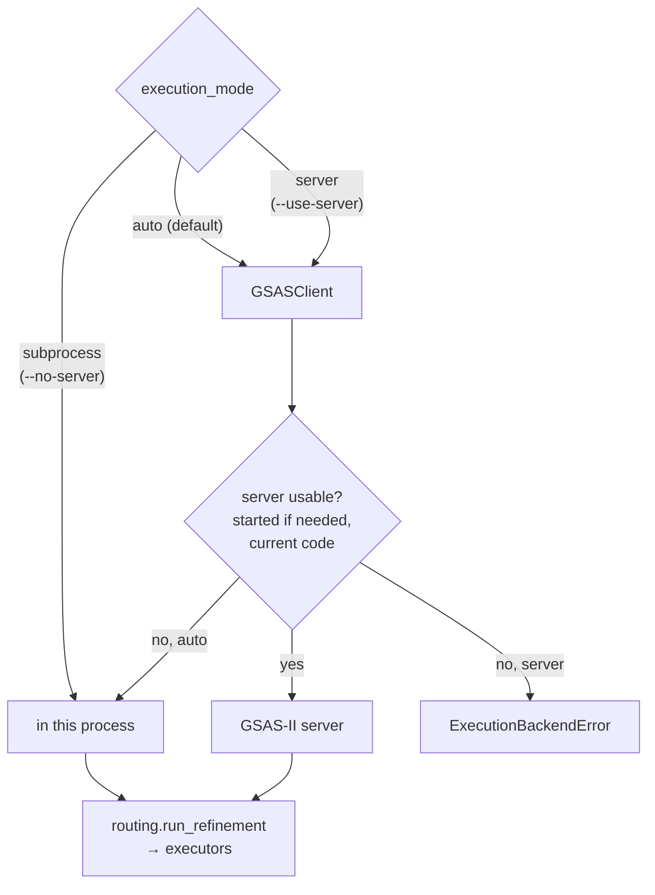
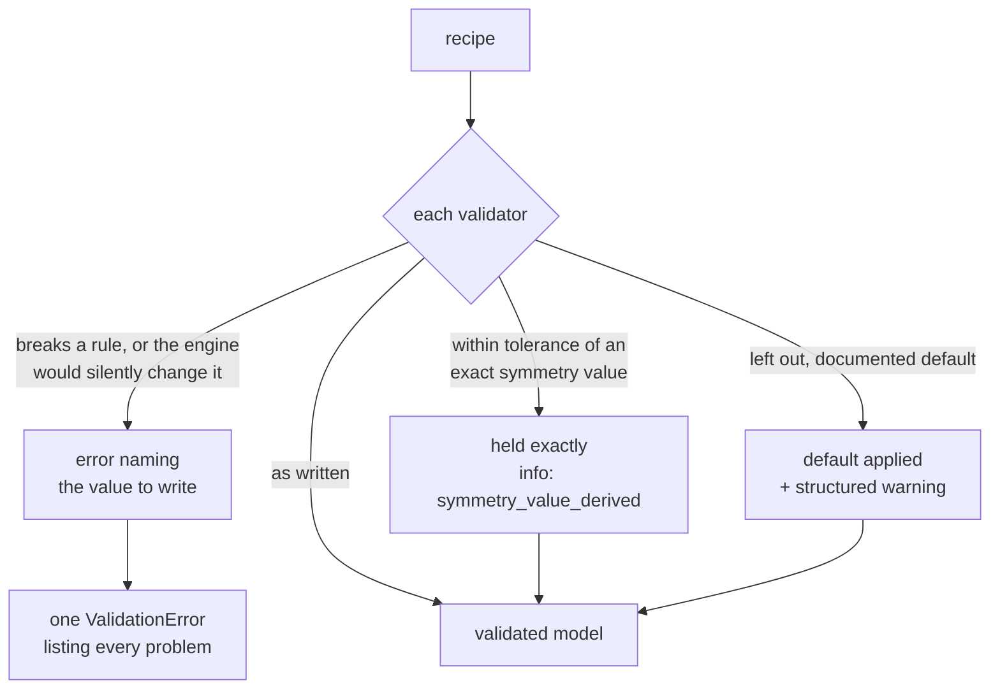

# Architecture

This page is for contributors and engine developers. It shows how the
package is laid out, what happens during a run, and which parts of the code
carry which guarantees. For the rules that bind a change, see
[Policies](policies.md).

## Design principles

- **Example-driven.** Features are added when a real refinement case needs
  them. The examples are also the regression references.
- **Schema-first.** Every rule a recipe must obey lives in the schema models.
  Validation reports every problem at its field before any engine runs.
- **Honest.** An engine's silent default, floor or conversion is refused at
  validation, with the value to write, or reported as a structured warning.
  It is never papered over.
- **Engine-native.** Nothing is translated between engines. A recipe states
  the numbers its engine computes with, in that engine's units.
- **Reproducible.** The same recipe produces the same refinement, and the
  reference outputs are tracked in the repository.

## Package architecture



The core is installed in every pixi environment and never imports an engine.
Each gateway adapts one engine. Its engine lives in its own environment, or,
for TOPAS, on the machine that has TOPAS installed. The `dev` environment
holds every engine plus the docs and test tooling. See
[Install](../getting-started/install.md) for the environments.

## Package map

### Core (`src/powderline/`)

| Module | Role |
|---|---|
| `__init__.py` | The public API (`__all__`): `run`, `validate`, `ValidationResult`, `load_recipe_asset`, `support_matrix` and the exceptions |
| `api.py` | `validate()` and `run()`: resolve the gateway from `schema_name` and hand the recipe over |
| `kicker.py` | The command line (`powderline`); refuses templates, maps engine flags onto gateway options |
| `doctor.py` | `powderline --doctor`: gateways found, engine versions against their pins, server state |
| `registry.py` | Gateway discovery from entry points, the `Gateway` dataclass, `register_gateway`, `check_engine_version` |
| `schema_core.py` | Core schema: the recipe frame, parameter shapes, data, fit range, Chebyshev background, the phase block, and the building blocks engine schemas are made from |
| `symmetry.py` | gemmi-backed symmetry: canonical space-group names, cell ties, special positions, coupling groups |
| `compat.py` | Declared schema compatibility, `schema_declarations()`, `support_matrix()` |
| `fitstats.py` | The uniform Rwp, Rexp, GoF and reduced χ² |
| `reports.py` | The standardized report writers and the list of fixed file names |
| `results.py` | The result envelope: status values, failure reasons, `raise_if_failed` |
| `roundtrip.py` | The output recipe and the parameter dispositions |
| `recipes.py` | `load_recipe_asset` and recipe block helpers |
| `exceptions.py` | The exception classes and `WARNING_CODES`, the registry of structured-warning codes |
| `config_loader.py` | Reads `.powderline_config.yaml` (simulation defaults) |
| `_status.py` | Console status glyphs |

### Gateways (`src/powderline/gateways/<engine>/`)

Every gateway has the same two layers.

- **Schema layer:** `schema.py`. It holds the engine schema models built on
  `schema_core`, the version declarations (`DECLARATIONS`), `SCHEMA_NAMES` and
  `validate_recipe`. It imports no engine. `powderline.validate()` runs only
  this layer.
- **Runtime layer:** `gateway.py` and the modules that drive the engine.
  `gateway.py` exports the entry-point factory `get_gateway()` and
  `ENGINE_VERSION_SPEC`. The engine is imported lazily, from `run()`.

| Gateway | Runtime modules |
|---|---|
| `gsasii/` (GSAS-II 5.7.9) | Frozen: `helpers.py`, `project.py`, `setters.py`, `executors.py`, `extractors.py`, `constraints.py`. Around them: `routing.py`, `fit_report.py`, `sites.py`, `paths.py`, `report_rows.py`, `console.py`, `scattering.py`, `server.py`, `client.py`, `simulation_builder.py` |
| `topas/` (TOPAS 6) | `native_writer.py` (model to INP and `.xye`), `native_run.py` (runs `tc.exe`, reads its files), `peak_list.py`, `runner.py` (finds `tc.exe`), `scattering.py` |
| `easydiffraction/` (0.21.1) | `native_builder.py` (model to an easydiffraction project), `native_run.py`, `space_group_table.py`, `space_group_support.py`, `scattering.py` |

`gsasii/simulation_builder.py` (`SimulationRecipeBuilder`) turns a
crystal-structure dict into a `gsasii.rietveld` simulation recipe, with
`refinement_cycles: 1` and every refine flag `false`:

- **Input:** `space_group`, `unit_cell`, `formula`, an optional
  `material_id`, and `sites`, which lists every atom of the full conventional
  cell. The builder reduces `sites` to one atom per orbit, and refuses a list
  whose atom count does not match each site's multiplicity.
- **Space group:** written as its canonical name. A group with two origins,
  given in origin choice 1, is moved to origin choice 2, because GSAS-II
  cannot use origin 1.
- **Defaults:** every value is stated in the recipe, in GSAS-II's units. SH/L
  is 0.002, GSAS-II's floor. The built-in defaults are overridden by a
  `simulation_defaults` dict, which `config_loader.ConfigLoader` reads from
  `.powderline_config.yaml`. Unknown keys there are errors.

### No engine at import time

`import powderline`, `powderline.api`, `powderline.kicker` and the schema
layer of every gateway import no engine. Subprocess tests block the engine
imports and fail if one slips in. Keep engine imports inside code that runs
from `run()`.

```{note}
The `pixi run test` suite installs a guard that makes any engine import fail.
`POWDERLINE_CORE_GUARD=1` forces the guard on for a hand-picked selection;
`=0` turns it off.
```

### Entry points

Gateways are discovered from the `powderline.gateways` entry-point group in
`pyproject.toml`:

```toml
[project.entry-points."powderline.gateways"]
gsasii = "powderline.gateways.gsasii.gateway:get_gateway"
topas = "powderline.gateways.topas.gateway:get_gateway"
easydiffraction = "powderline.gateways.easydiffraction.gateway:get_gateway"
```

There is no in-code fallback. The in-repo gateways use exactly the mechanism a
third-party gateway would.

```{important}
Entry-point metadata is written when the package is installed. After you
edit `[project.entry-points]` or `[project.scripts]`, run
`pixi reinstall powderline --all`, because every environment has its own install.
Until then the registry finds nothing ({ref}`KI-13 <ki-13>`).
```

`register_gateway(name, factory)` registers a gateway in code. It is meant
for tests and development, and takes precedence over an entry point of the
same name.

## A run, step by step



1. The CLI or `powderline.run()` reads the engine from `schema_name`
   (`<engine>.<workflow>`) and asks the registry for that gateway.
2. The recipe is validated through the gateway's schema layer. An invalid
   recipe raises one `pydantic.ValidationError` and nothing on disk changes.
3. `run()` checks that the engine is importable. Only then does it remove
   PowderLine's fixed-name files from the output directory.
4. The gateway checks the installed engine version against
   `ENGINE_VERSION_SPEC` and runs the engine:
   - **gsasii:** `routing.run_refinement` in this process or on the GSAS-II
     server, then `executors.run_refinement` and GSAS-II's scripting API.
   - **topas:** `native_writer` writes the INP and `.xye`, `tc.exe` runs, and
     `native_run` reads TOPAS's files. Without `tc.exe` the run is
     generate-only.
   - **easydiffraction:** `native_builder` builds the project, then a fit or a
     calculation runs, and `native_run` reads the result.
5. The gateway computes the uniform statistics, builds the output recipe and
   writes the report files.
6. A failed run raises. `run()` writes the failed envelope to `failure.json`
   beside the engine's own files and re-raises. No result table is written.

With `validate_only=True` the gateway returns a summary and runs nothing.
See [Outputs](../reference/outputs.md) for the result dict and
[Results](../concepts/results.md) for what the failure path means to a user.

## GSAS-II execution modes



| Mode | CLI | Behaviour |
|---|---|---|
| `auto` | default | Uses the server, starting it if needed; runs in-process if it is unavailable |
| `server` | `--use-server` | Server only; fails if the server cannot be used |
| `subprocess` | `--no-server` | Skips the server; GSAS-II runs in the calling process, despite the name |

The server (`server.py`, with `client.py` as its client) keeps GSAS-II
imported in one process, so a batch of runs pays GSAS-II's import once. Its
security model:

| Aspect | What the code does |
|---|---|
| Owner | One server per user. A kernel-held lock in the state directory allows a single server. |
| Network | Binds the loopback address `127.0.0.1` only, on a free port or `POWDERLINE_SERVER_PORT`. |
| Authentication | A random token, made at each start, signs every request and every response with an HMAC over method, path, nonce, timestamp and body. The token never travels. A client never trusts a listener that cannot sign. |
| Unsigned requests | A request without well-formed signing headers is refused before its body is read. |
| Token storage, Linux and macOS | A private state directory, mode 0700. The server refuses one that another user owns or can reach, or that is a symlink. |
| Token storage, Windows | `%LOCALAPPDATA%\powderline`, protected by the user profile's ACL. PowderLine does not check that ACL. |
| Files | Each job runs in a private scratch directory. Output files travel back inside the signed response, so client and server need no shared filesystem. |

`POWDERLINE_NO_SERVER=1` turns the server off. Operating the server is
covered in [Run at a beamline](../how-to/beamline-operation.md).

```{warning}
The server caches the code it loaded. After editing anything it runs, stop
it with `pixi run -e gsasii gsas-server stop`; the next `auto` or `server` run
starts a fresh one in the background. `gsas-server restart` and `start` run
the server in the foreground of that terminal until you stop it. The client
compares the server's PowderLine version and source-tree hash with its own. A
stale server is skipped in `auto` mode and refused in `server` mode.
```

A server timeout never falls back to an in-process run. The job is still
running on the server, so a second run would double the work.

## The validation model



- Every recipe check is a pydantic validator. An invalid recipe raises
  **one** `pydantic.ValidationError` listing every problem at its field path.
  There is no PowderLine wrapper exception for invalid recipes.
- Validation never changes what a recipe means. The validated model holds the
  recipe's values, the documented defaults and the exact symmetry-derived
  values. A value an engine would silently replace is an error, never an
  adjustment.
- Structured warnings (`{code, message, field_path[, level]}`) are collected
  once from the validated model. Re-validating the same recipe reproduces
  them. Every code is registered in `exceptions.WARNING_CODES` and listed in
  [Messages](../reference/messages.md).
- An engine schema builds on core but cannot redefine, skip or rewrite core's
  rules. This is guarded when the class is defined, and
  `tests/test_phase_canary.py` runs core's must-fail recipes through every
  engine's phase model.
- A schema rule that exists because of an engine quirk cites its public
  `EB-NN` ID in the error message. The entries are on the
  [Engines](../engines/index.md) pages.

Why validation is this strict is explained in
[Validation](../concepts/validation.md).

## The frozen GSAS-II modules

Six modules in `src/powderline/gateways/gsasii/` hold the hand-written
functions that set up and run a GSAS-II refinement: `helpers.py`,
`project.py`, `setters.py`, `executors.py`, `extractors.py` and
`constraints.py`. They manipulate GSAS-II's project dictionary directly.
These conventions can't be fully pinned down by tests, so the modules are
frozen.

- A behaviour-changing edit needs the maintainers' explicit consent.
- Comment and docstring edits need no consent.
- `src/powderline/_code_hash.json` holds a hash of each module's raw bytes,
  and `tests/test_code_hash.py` fails when a module changes. After **any**
  edit, run `pixi run update-code-hash` and commit the hash file with the
  change.

The full rule is on [Policies](policies.md#frozen-gsas-ii-code). New
behaviour goes into the modules around the frozen code:

| Module | What it adds |
|---|---|
| `sites.py` | Compares GSAS-II's site symmetry and multiplicity for every atom with core's. Stops with an error when GSAS-II misreads a site, or cannot name one while a coordinate or `Uaniso` is refined |
| `fit_report.py` | Computes the uniform statistics over the fit window. Reads GSAS-II's stored messages into warnings, its convergence flag and its count of varied parameters. Raises on a non-finite calculated pattern |
| `routing.py` | One entry point for in-process, server and client runs |
| `paths.py` | Maps GSAS-II parameter names to recipe paths for the output recipe |
| `console.py` | Keeps the tail of GSAS-II's console text for a failed run's envelope |
| `scattering.py` | GSAS-II's ion table and spelling |
| `gateway.py` | The version check, the execution modes and the result tables |

The documented gsasii defaults (sample broadening, background, cycles) are
schema defaults. The frozen setters always receive explicit values, so
GSAS-II's own defaults are never used. GSAS-II sets refine flags in lumps (one
for the cell, one for all three coordinates of an atom). `constraints.py`
sets the lumped flag and adds GSAS-II "Hold" constraints for the parts the
recipe does not refine. The schema has already refused any flag pattern
GSAS-II could not honour.

## Output generation

Every engine writes the same fixed file names through `powderline.reports`:
`refined_parameters.csv`, `<phase>_unit_cell_report.csv`,
`<phase>_peak_list_report.csv` and `fit_profile.txt`. A single-peak fit adds
a peak report. A refinement adds `output_recipe.json` and
`parameter_dispositions.csv`. The writers use one column order, UTF-8 and LF
line endings, so the files are byte-stable across platforms.

The engines' own files stay beside them. gsasii keeps `dummy.gpx` and
`dummy.lst`. topas keeps the INP, the `.xye` and every file TOPAS wrote.
`powderline.run()` removes only the names in `reports.FIXED_OUTPUT_NAMES` and
`reports.FIXED_OUTPUT_PATTERNS`, never an engine's files. The full list is on
[Outputs](../reference/outputs.md).

The output recipe is built in core by `roundtrip`. A gateway hands it the
refined values by recipe path, in recipe units, with their ESDs. It also
names the flagged paths the engine did not vary and those that ended at a
limit. Core does the rest: tie propagation, the multiplicity check,
`output_recipe`, `output_recipe_valid` and `parameter_dispositions`.

## Domain essentials

**Rietveld refinement** fits a calculated powder pattern to the observed one
by adjusting structural, profile and background parameters. PowderLine
computes the headline statistics once, in `fitstats`, the same way for every
engine:

$$R_{wp} = 100 \sqrt{\frac{\sum_i w_i (y_{obs,i} - y_{calc,i})^2}{\sum_i w_i y_{obs,i}^2}}, \qquad
R_{exp} = 100 \sqrt{\frac{N - P}{\sum_i w_i y_{obs,i}^2}}, \qquad
\mathrm{GoF} = \frac{R_{wp}}{R_{exp}}$$

The sums run over the points inside the fit window with $w_i > 0$. $N$ is
the number of those points. $P$ is the engine's own count of varied
parameters, read after the run. Reduced χ² is $\mathrm{GoF}^2$. The engine's
own values go under `engine_details`.

```{tip}
A lower Rwp means a better fit of *that model* to *those points*. Across
engines, compare lattice parameters rather than Rwp: the models differ.
```

**Parameter types.** Every refinable is a `[value, flag]` or
`[value, flag, min, max]` list.

- Structural: cell, coordinates, occupancies, ADPs. This is core's phase
  block, identical in every engine.
- Intensity: the phase `scale`.
- Peak shape: sample size and strain (gsasii, topas) and the instrument
  profile (every engine).
- Background: Chebyshev terms, and background peaks in gsasii and topas.
- Instrument: wavelength, zero shift, polarization, asymmetry, in the engine's
  own names and units.

**Phase and histogram parameters.** Phase parameters belong to a crystal
structure: cell, atoms, scale and sample broadening. Histogram parameters
belong to the measurement: instrument profile and background. In a
multi-phase refinement the histogram parameters are shared.

Terms used here (recipe, gateway, tie group, special position) are defined in
the [Glossary](../reference/glossary.md). Contributor terms: a **golden** is a
committed engine output a test compares against; the **schema layer** and
**runtime layer** are the engine-free and engine-importing halves of a
gateway.
