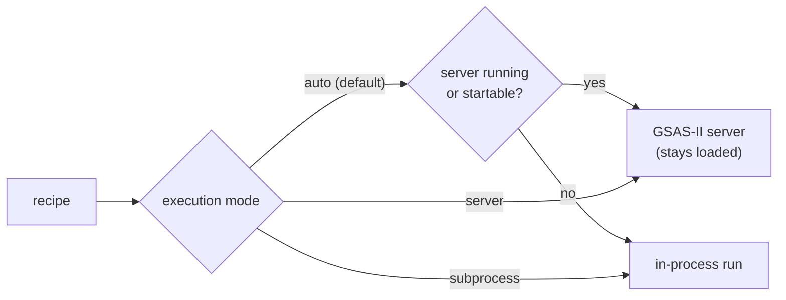

# GSAS-II

| | |
|---|---|
| Version | 5.7.9, installed by `pixi install --frozen -e gsasii` |
| Workflows | `gsasii.rietveld` (Rietveld refinement), `gsasii.spf` (single-peak fitting) |
| Parameters | `[value, flag]`, no bounds |
| Platforms | Linux, Windows, macOS |
| Run | `pixi run -e gsasii powderline <recipe.json>` |
| Cite | Toby & Von Dreele (2013) and O'Donnell et al. (2018), see [Citing](../about/citing.md) |

## What you write

A minimal `gsasii.rietveld` recipe for LaB6. It validates as shown; your
measured pattern replaces the three data points.

```json
{
  "schema_name": "gsasii.rietveld",
  "core_schema_version": "0.1.0",
  "engine_schema_version": "0.1.0",
  "payload": {
    "xrd_data": {
      "tth": [1.000, 1.004, 1.008],
      "Itth": [30.7, 29.8, 31.2],
      "Itth_weights": [0.0326, 0.0335, 0.0320]
    },
    "instrument": {
      "radiation": {"type": "PXC", "wavelength": [0.1665, false]},
      "geometry": {"bank": 1, "azimuth": 0.0},
      "corrections": {
        "zero_shift": [0.0, false],
        "polarization": [0.99, false],
        "axial_divergence": [0.002, false]
      },
      "broadening": {
        "U": [18.7, true], "V": [0.60, true], "W": [1.15, true],
        "X": [0.28, true], "Y": [0.001, false], "Z": [0.0, false]
      }
    },
    "phases": {
      "LaB6": {
        "space_group": "P m -3 m",
        "unit_cell": {
          "a": [4.15682, true], "b": [4.15682, true], "c": [4.15682, true],
          "alpha": [90.0, false], "beta": [90.0, false], "gamma": [90.0, false]
        },
        "atoms": {
          "La": {"element": "La", "x": [0.0, false], "y": [0.0, false], "z": [0.0, false],
                 "occupancy": [1.0, false], "ADP": "Uiso", "Uiso": [0.0086, false]},
          "B": {"element": "B", "x": [0.5, false], "y": [0.5, false], "z": [0.2021, false],
                "occupancy": [1.0, false], "ADP": "Uiso", "Uiso": [0.009, false]}
        },
        "scale": [1.0, true]
      }
    },
    "refinement_controls": {"refinement_cycles": 5}
  }
}
```

**Required in `gsasii.rietveld`:**

- `xrd_data`: `tth`, `Itth`, `Itth_weights`.
- `instrument` with all four blocks: `radiation`, `geometry`, `corrections`,
  `broadening`.
- At least one phase in `phases`, each with `space_group`, `unit_cell`,
  `atoms` and `scale`. `scale` is ≥ 0. A `scale` of 0 is accepted, so a
  recipe can be reused with its scale still to be set.
- `refinement_controls`.

**Optional:** `fit_range`; `background`; `instrument.description`; and per
phase `peak_broadening`, `scattering_types` and `preferred_orientation`.
The recipe above leaves out `background` and `peak_broadening`, so it
validates with three default warnings: one for the background, and one each
for size and strain broadening (see [Defaults](#defaults)).

**`gsasii.spf`** (single-peak fitting) has no `phases`. It needs `xrd_data`,
`instrument` as above, `single_peaks` and `refinement_controls` with
`single_peak_fitting_mode.use_instrument_profile`. `single_peaks` holds four
lists of the same length: `positions`, `intensities`,
`pv_gaussian_sigma_sq` and `pv_lorentzian_gamma`. `fit_range` and
`background` are optional. Start from
`examples/example_LaB6_singlepeakfit/input.json`.

Every field, with its unit: [Fields: `gsasii.rietveld`](../reference/fields.md#gsasiirietveld)
and [Fields: `gsasii.spf`](../reference/fields.md#gsasiispf).

### Units that differ from other engines

| Quantity | GSAS-II unit |
|---|---|
| `U`, `V`, `W` (Gaussian variance) | centidegree² |
| `X`, `Y`, `Z`, `zero_shift` | centidegree |
| `axial_divergence` (SH/L) | dimensionless |
| `pv_gaussian_sigma_sq` (peak σ²) | centidegree² |
| `pv_lorentzian_gamma` (peak γ) | centidegree |
| crystallite size | µm |
| microstrain | Δd/d × 10⁶ |

GSAS-II's Lorentzian width is X/cosθ + Y tanθ. In TOPAS and easydiffraction
it is X tanθ + Y/cosθ: the roles of X and Y swap.

### Defaults

GSAS-II recipes are the only ones with defaults. A new GSAS-II project would
add sample broadening and a background you did not ask for
({ref}`EB-36 <eb-36>`). PowderLine applies its own defaults instead, each with
a warning, so you always know one was used.

| Left out | Used instead | Warning |
|---|---|---|
| `peak_broadening` (size or strain) | 10 µm size, 0 microstrain, isotropic, fixed | `gsasii_broadening_default_applied` |
| `background` (or its `chebyshev`) | no background: one fixed Chebyshev term 0.0 | `gsasii_background_default_applied` |
| `refinement_cycles` | 5 | `gsasii_refinement_cycles_default_applied` |

State the block to silence its warning.

### Bounds

`gsasii.*` recipes have no bounds. GSAS-II applies a limit only after all
cycles, and freezes the value for the next call ({ref}`EB-30 <eb-30>`,
{ref}`EB-31 <eb-31>`, {ref}`KI-06 <ki-06>`). A 4-element parameter list is a
validation error. Bounds in every engine: [Recipe format](../reference/recipe-format.md#bounds).

## The instrument block

`instrument` is the only source of GSAS-II's instrument parameters. The
gateway builds GSAS-II's own parameter dictionary from it. There is no
pasted GSAS-II parameter block, and no `null` that means "take the engine's
value".

| Block | Fields |
|---|---|
| `radiation` | `type: "PXC"`, `wavelength` |
| `geometry` | `bank`, `azimuth` |
| `corrections` | `zero_shift`, `polarization` (GSAS-II's P), `axial_divergence` (SH/L) |
| `broadening` | `U`, `V`, `W`, `X`, `Y`, `Z` |
| `description` | optional free text |

- `axial_divergence` must be at least 0.002, GSAS-II's own evaluation floor
  ({ref}`EB-37 <eb-37>`).
- `type` is `"PXC"` only. Kα doublets, time-of-flight and neutron data are
  not supported.
- A wavelength ≤ 0 is a validation error. GSAS-II itself would fail with "no
  reflections".

## Background and controls

- `background.chebyshev` is the shared Chebyshev model: `num_coefficients`,
  `coefficients`, and one `refine_flag` for all terms. Its basis spans the
  fit window's first and last points.
- `background.single_peaks` adds pseudo-Voigt background peaks. Each must lie
  inside the fit window ({ref}`EB-38 <eb-38>`), with values at or above
  GSAS-II's floors ({ref}`EB-35 <eb-35>`).
- `refinement_controls.refinement_cycles` sets the number of cycles.
  `1` is a simulation: then every refine flag must be `false`, including
  polarization and the Peak List flags.

### Preferred orientation

`preferred_orientation` is March–Dollase, per phase:

```json
"preferred_orientation": {"model": "march_dollase", "hkl": [0, 0, 1], "ratio": [0.8, true]}
```

- `hkl` holds integers, not all zero. The ratio r must be > 0.
- GSAS-II's convention: r = 1 is random, r < 1 platy, r > 1 needle. The
  correction is averaged over the symmetry equivalents of the axis.
- The refined ratio maps back to `…preferred_orientation.ratio` in the output
  recipe.

:::{warning} Don't start the ratio at exactly 1.0 in a cubic phase
There the correction is stationary, so no step lowers χ². GSAS-II aborts, and
PowderLine reports the run as failed, reason `diverged`
({ref}`EB-99 <eb-99>`). On the textured LaB6 example, a start at 0.9 goes
non-finite and a start at 1.2 settles on the needle-side minimum, r = 1.73.
Start on the side of 1 you expect.
:::

## How PowderLine runs GSAS-II



A GSAS-II recipe runs in one of three execution modes. `auto`, the default,
uses a persistent GSAS-II server that stays loaded between runs, and falls
back to an in-process run. `server` (`--use-server`) uses the server only,
and `subprocess` (`--no-server`) runs in PowderLine's own process. Both paths
produce the same files and results.

```python
result = powderline.run(recipe, "output", execution_mode="subprocess")
```

How to start, check and secure the server, and how to limit the wait for it:
[Run at a beamline](../how-to/beamline-operation.md).

### Convergence and failures

- GSAS-II's convergence flag becomes the result's `converged`. When the last
  cycle's χ² change was above GSAS-II's tolerance, the result warns
  `gsasii_fit_not_converged` and keeps the values. A Peak List fit keeps no
  flag, so `converged` is `None` there. The committed DRX_33 examples report
  `converged: false` after their five cycles.
- A crystallite size ≤ 0 is a validation error. GSAS-II itself would fail
  with an SVD failure.
- After phase setup, the gateway checks GSAS-II's reading of every site. A
  site it misreads stops the run with reason `unusable_site`, naming a
  position to write instead ({ref}`EB-40 <eb-40>`, {ref}`EB-05 <eb-05>`).
- A run that fails raises an error. Its directory keeps `failure.json` and the
  console text GSAS-II printed ({ref}`KI-05 <ki-05>`). Details:
  [Outputs](../reference/outputs.md#when-a-run-fails).

## Behaviours

Each entry says what GSAS-II does on its own and what PowderLine does about
it. Messages and the changelog cite these IDs.

```{include} ../_generated/eb_gsasii.md
```
