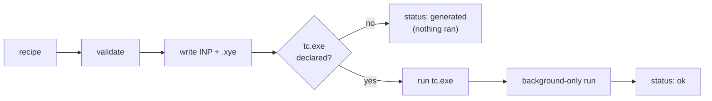

# TOPAS

| | |
|---|---|
| Version | TOPAS 6. The recipe states `"engine_version": "6"`. TOPAS is installed separately: it has no Python package. |
| Workflows | `topas.rietveld` (Rietveld refinement), `topas.spf` (single-peak fitting) |
| Parameters | `[value, flag, min, max]` |
| Platforms | Validation and input files: Linux, Windows, macOS (not routinely tested). Running TOPAS: Windows, with `tc.exe`. |
| Run | `pixi run powderline <recipe.json> --topas-version 6 --topas-dir C:/TOPAS6` |
| Cite | Coelho (2018), see [Citing](../about/citing.md) |

## What you write

A minimal `topas.rietveld` recipe for LaB6. It validates as shown; your
measured pattern replaces the three data points.

```json
{
  "schema_name": "topas.rietveld",
  "core_schema_version": "0.1.0",
  "engine_schema_version": "0.1.0",
  "engine_version": "6",
  "payload": {
    "xrd_data": {
      "tth": [1.000, 1.004, 1.008],
      "Itth": [30.7, 29.8, 31.2],
      "Itth_weights": [0.0326, 0.0335, 0.0320]
    },
    "instrument": {
      "radiation": {
        "ymin_on_ymax": 0.0001,
        "la": [1.0, false, null, null],
        "lo": [0.1665, false, null, null],
        "lh": [0.0001, false, null, null]
      },
      "broadening": {
        "peak_type": "TCHZ_Peak_Type",
        "parameters": {
          "U": [0.0104, true, null, null], "V": [0.00033, true, null, null],
          "W": [0.00064, true, null, null], "Z": [0.0, false, null, null],
          "X": [0.0001, true, null, null], "Y": [0.0028, true, null, null]
        }
      }
    },
    "phases": {
      "LaB6": {
        "space_group": "P m -3 m",
        "unit_cell": {
          "a": [4.15682, true, null, null], "b": [4.15682, true, null, null],
          "c": [4.15682, true, null, null], "alpha": [90.0, false, null, null],
          "beta": [90.0, false, null, null], "gamma": [90.0, false, null, null]
        },
        "atoms": {
          "La": {"element": "La", "x": [0.0, false, null, null], "y": [0.0, false, null, null],
                 "z": [0.0, false, null, null], "occupancy": [1.0, false, null, null],
                 "ADP": "Uiso", "Uiso": [0.0086, false, null, null]},
          "B": {"element": "B", "x": [0.5, false, null, null], "y": [0.5, false, null, null],
                "z": [0.2021, false, null, null], "occupancy": [1.0, false, null, null],
                "ADP": "Uiso", "Uiso": [0.009, false, null, null]}
        },
        "scale": [2.6e-06, true, null, null]
      }
    },
    "refinement_controls": {"iters": 1000, "chi2_convergence_criteria": 0.001, "x_calculation_step": 0.001}
  }
}
```

**Required in `topas.rietveld`:**

- `engine_version` (`"6"`) at the top level, next to `payload`.
- `xrd_data`: `tth`, `Itth`, `Itth_weights`.
- `instrument.radiation` (`ymin_on_ymax`, `la`, `lo`, `lh`) and
  `instrument.broadening` (`peak_type` and exactly that type's
  `parameters`).
- At least one phase, with `space_group`, `unit_cell`, `atoms` and `scale`.
- `refinement_controls`, every control stated: `iters`,
  `chi2_convergence_criteria`, `x_calculation_step`.

**Optional:** `fit_range`, `background`, `instrument.corrections`,
`instrument.geometry`, and per phase `peak_broadening`, `scattering_types`
and `preferred_orientation`.

**`topas.spf`** (single-peak fitting) is the same, with `single_peaks`
instead of `phases`. `single_peaks` is a list of peaks, each with `xo` and
`I`, and optionally `gauss_fwhm` and `lor_fwhm`. Start from
`examples/example_LaB6_singlepeakfit/topas/input.json`.

Every field, with its unit: [Fields: `topas.rietveld`](../reference/fields.md#topasrietveld)
and [Fields: `topas.spf`](../reference/fields.md#topasspf).

### Units that differ from other engines

| Quantity | TOPAS unit |
|---|---|
| `U`, `V`, `W`, `Z` (TCHZ, Gaussian FWHM²) | degree² |
| `X`, `Y` (TCHZ, Lorentzian FWHM) | degree |
| `lo` (wavelength) | Å |
| `lh`, `lg` (emission-line half-widths) | mÅ |
| `Rp`, `Rs`, slit and sample lengths | mm |
| `CS_L`, `CS_G` | nm |
| `Strain_L`, `Strain_G` | degree 2θ |
| capillary `u_cm_inv` | 1/cm |
| `Uiso` | Ų, as in every schema; written to TOPAS as `beq` ({ref}`EB-24 <eb-24>`) |

The TCHZ letters are not GSAS-II's. TOPAS's U, V, W give the Gaussian FWHM²
in degree². Its Lorentzian term is X tanθ + Y/cosθ, where GSAS-II's is
X/cosθ + Y tanθ: the roles of X and Y swap.

`CS_L`, `CS_G`, `Strain_L` and `Strain_G` are not sizes or strains. PowderLine
reports LVol-IB and e0, computed by TOPAS, as derived rows
({ref}`EB-57 <eb-57>`).

### Nothing has a default

A block you leave out is not modelled. Everything PowderLine would otherwise
choose is a required field. A recipe without `background` has no background.

### Bounds

`[value, flag, min, max]`: a stated `min` or `max` replaces TOPAS's own
default limit on that side. `null` keeps TOPAS's default limit
({ref}`EB-58 <eb-58>`).

- A refined start outside a default limit on a `null` side is a validation
  error. State a bound to override TOPAS, or start inside.
- TOPAS 6 stops a little past a bound, not on it. A `PO` ratio with min 0.7
  ended at 0.700012. A single-peak position stopped 1e-5° inside the fit
  window's start, where TOPAS holds `xo`.
- After a run, every refined value within 1e-4 (relative) of a stated bound or
  a default limit gets `topas_parameter_at_limit`. At a limit of 0 the
  tolerance is 1e-12 absolute.
- A single-peak position counts as at the window's edge when no data point
  lies between it and the edge, or when it is on or beyond the edge.

Bounds in every engine: [Recipe format](../reference/recipe-format.md#bounds).

## The instrument block

| Block | Fields |
|---|---|
| `radiation` | One `lam` emission line: `ymin_on_ymax`, `la` (area), `lo` (wavelength, Å), `lh` (mÅ), optionally `lg` (mÅ) |
| `geometry` (optional) | `Rp`, `Rs` in mm. State them exactly when an axial model reads them. |
| `corrections` (optional) | Keyed by TOPAS macro: `Zero_Error`; `LP_Factor` *or* `LP_Factor_Synchrotron`; `Simple_Axial_Model` *or* `Full_Axial_Model`; `capillary` |
| `broadening` | `peak_type` and its `parameters`: `TCHZ_Peak_Type` (U, V, W, Z, X, Y), `PV_Peak_Type` or `PVII_Peak_Type` |

- `lh` is required. `lg` is allowed only with it: `lg` alone crashes TOPAS 6
  ({ref}`EB-64 <eb-64>`).
- Geometry corrections act on every peak, background and single peaks
  included. Lorentz–polarization acts on Bragg peaks only.
- With `TCHZ_Peak_Type`, the total peak width at the starting values must be
  positive at every data point of the fit window. A negative Lorentzian part
  X·tanθ + Y/cosθ is allowed while it is. Otherwise validation fails with
  `topas_tchz_width_not_positive` ({ref}`EB-69 <eb-69>`).

## Background and controls

- `background.chebyshev` is the shared Chebyshev model: `num_coefficients`,
  `coefficients`, and one `refine_flag` for all terms. Its basis spans the
  fit window's first and last points.
- `background` also takes `One_on_X` and `xo_Is` `peaks`, each peak with its
  own peak type.
- `refinement_controls`: `iters`, `chi2_convergence_criteria` and
  `x_calculation_step`, all required. `iters: 0` is a simulation: then every
  refine flag must be `false`.

### Scattering types and preferred orientation

- **Ions** are stated in the CIF spelling in `scattering_types`, for example
  `La3+`. The writer puts TOPAS's spelling into the site's `occ`:
  `occ La+3 …`. TOPAS takes its form factors from `ATMSCAT.CPP`, which has
  113 ions in TOPAS 6. An ion outside that table is a validation error.
  TOPAS itself stops without results on `La3+`, on a sign-only `Na+` or an
  unknown symbol, with no neutral fallback. See
  [Scattering types by engine](index.md#scattering-types-by-engine).
- **Preferred orientation** is TOPAS.INC's `PO` macro. `PO(c, r, , h k l)` is
  GSAS-II's March–Dollase correction, averaged over the axis's equivalents
  with the same r convention. The two agree to 1.4e-7 along 001, 111 and
  110. Refined from 0.8 on the textured example, it recovers r = 0.5982(14)
  against the programmed 0.6.
- The `PO` macro's default limits are min 0.0001 and max 2r + 0.5. The max
  follows the value, so a start never exceeds it. The writer emits only the
  bounds you state. A refined start below 0.0001 with no stated `min` is a
  validation error.

## How PowderLine runs TOPAS



PowderLine always writes TOPAS's input file (`<base>.inp`) and the data
(`<base>.xye`). Numbers are written to 10 significant digits, in both files.

- **Where `tc.exe` is.** PowderLine looks only in the folder you give:
  `--topas-dir DIR`, or `topas.dir` in `.powderline_config.yaml` (in the
  current folder, or your home folder). It never guesses a folder.
- **Without `tc.exe`** the run is generate-only. The INP and `.xye` are
  written, nothing runs, and the result has `status: "generated"` with the
  note `topas_generate_only`. The command exits 0.
- **The version is declared, not detected.** `tc.exe` carries no version
  PowderLine could read ({ref}`EB-67 <eb-67>`). A run needs
  `--topas-version 6`, or `topas.version` in the config file.
- **Success is judged from TOPAS's output files.** `tc.exe` returns the same
  exit code on success and failure ({ref}`EB-60 <eb-60>`). A missing file
  fails the run with reason `output_missing`. Its failure record keeps the
  INP and data, and whatever `tc.exe` printed. Otherwise look at TOPAS's
  console window and `tc.log`.
- **Each `tc.exe` run has a time limit:** `--topas-timeout SECONDS`, or
  `topas.timeout` in the config file. The default is 3600 s; 0 means no
  limit. Past it, `tc.exe` is stopped and the run fails with reason
  `timeout`. So a TOPAS waiting for input cannot hang a run.
- **A second, background-only run** gives the fitted background, because
  TOPAS 6 cannot output it ({ref}`EB-61 <eb-61>`). If that run writes nothing
  or hits the time limit, the result is still a success, with an empty
  `y_bkg` and `topas_background_not_calculated`.
- **`converged` is always `null`** for TOPAS 6, which writes no convergence
  signal ({ref}`EB-85 <eb-85>`).

```python
result = powderline.run(recipe, "output", topas_dir=r"C:\TOPAS6", topas_version="6")
```

```yaml
# .powderline_config.yaml
topas:
  dir: C:/TOPAS6
  version: "6"
  timeout: 3600
```

Step by step: [Run TOPAS](../how-to/run-topas.md).

### Folder and file names on Windows

TOPAS reads file paths in the Windows ANSI code page. A folder whose name the
code page cannot hold, such as Greek on a Western-European Windows, makes
TOPAS 6 write nothing. Latin-1 names and spaces work.

- PowderLine passes such a folder to `tc.exe` in its 8.3 short form, with the
  file name as written.
- If the volume has no short name for the folder, the run is refused before
  `tc.exe` starts, with reason `backend_error` and a message to use an ASCII
  output folder.
- A base name that is not ASCII-safe is replaced by `topas`, with the warning
  `topas_base_name_sanitized`.

### TOPAS 7

`topas.*` recipes are verified against TOPAS 6 and declare TOPAS 6 only
({ref}`KI-16 <ki-16>`). TOPAS 7 needs an explicit widening, with its own
compatibility run.

## Behaviours

Each entry says what TOPAS does on its own and what PowderLine does about it.
Messages and the changelog cite these IDs.

```{include} ../_generated/eb_topas.md
```
