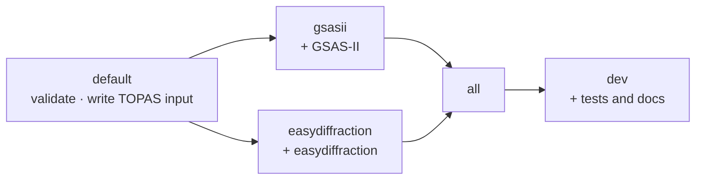

# Install

PowderLine installs with [pixi](https://pixi.sh), which also installs the
refinement engines. You need only pixi and git.

## 1. Get the code

```bash
git clone https://github.com/NSLS2/PowderLine.git
cd PowderLine
```

## 2. Choose an environment

Each engine lives in its own environment, so you install only what you use.

| Environment | Install | What it can do |
|---|---|---|
| default | `pixi install --frozen` | Validate any recipe. Write TOPAS input files. Runs no engine. |
| `gsasii` | `pixi install --frozen -e gsasii` | Everything above, plus run `gsasii.*` recipes with GSAS-II 5.7.9 |
| `easydiffraction` | `pixi install --frozen -e easydiffraction` | Everything above, plus run `easydiffraction.*` recipes with easydiffraction 0.21.1 |
| `all` | `pixi install --frozen -e all` | Both engines |
| `dev` | `pixi install --frozen -e dev` | Both engines plus test and docs tools (for contributors) |



For your first refinement, install `gsasii`:

```bash
pixi install --frozen -e gsasii
```

The first install downloads packages and builds GSAS-II. It takes a few
minutes; later runs start immediately.

:::{note}
Keep `--frozen`. It installs exactly the versions PowderLine was tested with,
as recorded in the repository's lock file.
:::

## 3. Check the installation

```bash
pixi run -e gsasii powderline --doctor
```

`--doctor` lists the engines this environment can run, each engine's version
against the version PowderLine requires, and the state of the GSAS-II server.
It exits with an error if something is wrong.

## Platforms

PowderLine runs on Linux, Windows and macOS (Apple Silicon). The commands on
these pages are the same on every platform. Run them from the repository
folder in your terminal: bash or zsh on Linux and macOS, PowerShell or
Command Prompt on Windows.

## TOPAS

TOPAS is commercial software with no Python package, so no environment
installs it. Every environment validates `topas.*` recipes and writes the
TOPAS input files. Running TOPAS needs a Windows computer with TOPAS 6
installed. See [Run TOPAS recipes](../how-to/run-topas.md).

## Using PowderLine from your own project

PowderLine is not yet on PyPI or conda-forge. To call it from another project,
see [Use PowderLine from Python and in pipelines](../how-to/python-pipelines.md).

**Next:** [Your first refinement](first-refinement.md).
