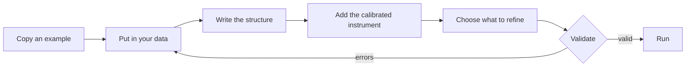

# Refine your own data

This tutorial takes you from your own pattern and structure to a validated,
running recipe. It assumes you have done [your first refinement](first-refinement.md).

You will need:

- your powder pattern, reduced to 2θ, intensity and uncertainty;
- a starting structure for each phase (from a CIF, a database or a paper);
- a pattern of a standard (LaB6, Si, CeO2) measured at the same wavelength
  and geometry.



## 1. Choose the engine and copy an example

A recipe is written for one engine, so choose it first. GSAS-II is the
reference engine and the easiest to start with. [Engines](../engines/index.md)
compares them.

Copy the example closest to your case into a folder of your own:

```bash
mkdir -p my_sample
cp examples/example_LaB6/input.json my_sample/input.json
```

`examples/example_template/` also holds a blank skeleton for each engine.

## 2. Put in your data

The pattern sits inside the recipe as three lists of equal length, in
`payload.xrd_data`:

| Key | What | Unit |
|---|---|---|
| `tth` | 2θ of each point, strictly increasing | degrees |
| `Itth` | measured intensity | any |
| `Itth_weights` | weight of each point, 1/σ² | 1/intensity² |

A short script can fill them from your reduced data. For example, from a
three-column text file of 2θ, intensity and σ:

```python
import json
import numpy as np

tth, inten, sigma = np.loadtxt("my_pattern.xye", unpack=True)

recipe = json.load(open("my_sample/input.json"))
recipe["payload"]["xrd_data"] = {
    "tth": tth.tolist(),
    "Itth": inten.tolist(),
    "Itth_weights": (1.0 / sigma**2).tolist(),
}
recipe["payload"]["fit_range"] = [2.0, 15.0]   # degrees 2θ; adjust to your data
json.dump(recipe, open("my_sample/input.json", "w"), indent=1)
```

:::{note}
PowderLine never repairs data. Sorting, removing duplicates, converting Q or
d to 2θ, and computing σ all happen before the data reach the recipe. A
weight of 0 excludes a point: use it to mask a detector gap rather than
deleting points.
:::

## 3. Write the structure

Each phase goes under `payload.phases`, keyed by a name made of letters,
digits and `_`:

```json
"phases": {
  "LaB6": {
    "space_group": "P m -3 m",
    "unit_cell": {"a": [4.15682, true], "b": [4.15682, true], "c": [4.15682, true],
                  "alpha": [90.0, false], "beta": [90.0, false], "gamma": [90.0, false]},
    "atoms": {
      "La": {"element": "La", "x": [0.0, false], "y": [0.0, false], "z": [0.0, false],
             "occupancy": [1.0, false], "ADP": "Uiso", "Uiso": [0.0086, false]},
      "B":  {"element": "B", "x": [0.2021, false], "y": [0.5, false], "z": [0.5, false],
             "occupancy": [1.0, false], "ADP": "Uiso", "Uiso": [0.0092, false]}
    },
    "scale": [1.0, true]
  }
}
```

Copy the values from your CIF with your own tools. Three things need care:

- **The space group** is written in one exact spelling, which also states the
  setting. If you write `"Pm-3m"`, validation tells you to write
  `"P m -3 m"`.
- **All six cell values** are stated, even when symmetry ties them, and tied
  values carry the same flag.
- **Atoms on special positions** need exact values: `0.5`, not `0.4999`;
  thirds to at least six decimals (`0.333333`), not `0.3333`.

[Validation](../concepts/validation.md) explains each rule and why it exists.

## 4. Add the calibrated instrument

Refine your standard first, then copy its refined instrument block into your
recipe with every flag set to `false`. [Calibrate the instrument](../how-to/calibrate-instrument.md)
walks through it.

## 5. Choose what to refine

Set the flags. Start with few: scale, background and cell. Add more in
stages, checking the fit at each step.

:::{important}
PowderLine checks that your recipe is well formed. It does not judge whether
your choices suit your data. Read [Good refinement practice](../concepts/refinement-practice.md)
before refining correlated parameters, such as crystallite size and
microstrain together.
:::

## 6. Validate, fix, repeat

```bash
pixi run powderline my_sample/input.json --validate-only
```

Validation lists every problem at once, each at its place in the recipe.
Most messages say what to write instead:

```text
❌ Recipe validation failed: my_sample/input.json

Validation errors:
  • payload -> instrument -> radiation: Field required
  • payload -> instrument -> radiaton: Extra inputs are not permitted
  • payload -> phases -> LaB6 -> space_group: Value error, space group 'Pm-3m'
    is not in the canonical form; write 'P m -3 m'
```

Fix them and run it again. Some checks only run once earlier problems are
fixed. For example, the cell is checked against the space group once the
space group is valid:

```text
  • payload -> phases -> LaB6 -> unit_cell: Value error, unit cell is
    inconsistent with 'P m -3 m' (cubic): stated b = 4.2, but by symmetry
    b = a; write b = 4.15682
```

When the recipe is valid, read the warnings. They report defaults PowderLine
applied and notes about your recipe. [Messages](../reference/messages.md)
lists every one.

## 7. Run it

```bash
pixi run -e gsasii powderline my_sample/input.json
```

Look at the fit (see [Plot the fit](first-refinement.md#plot-the-fit)), then
adjust the flags and run again. Each run's `output_recipe.json` holds the
refined values, ready to be the next starting point.

**Next:** [Run a series](../how-to/sequential-refinement.md) to refine many
patterns, or [Refine a structure](../how-to/refine-structure.md) to go further.
