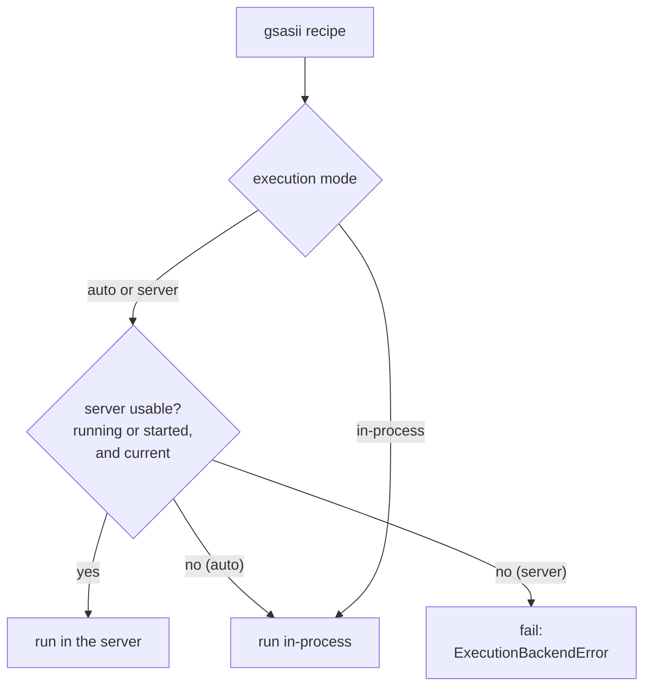

# Run at a beamline

**Goal:** run many refinements unattended on a beamline workstation, often
one shared by several users. Keep GSAS-II loaded between runs, run batches
of recipes, and find out what failed without watching every run.

**You need:**
- The environment of your engine ([Install](../getting-started/install.md)).
- Recipes that validate, with the instrument calibrated
  ([Calibrate the instrument](calibrate-instrument.md)).

## 1. Check the environment

```bash
pixi run -e gsasii powderline --doctor
```

The report lists the PowderLine version, the gateways it finds, each
engine's installed version against the version PowderLine supports, and the
GSAS-II server's state. In the core-only environment
(`pixi run powderline --doctor`) it looks like this:

```
PowderLine 0.2.0  (Python 3.13.15, Linux-…)
  python: …/.pixi/envs/default/bin/python
  gateways (3, from the powderline.gateways entry points):
    easydiffraction  workflows easydiffraction.rietveld requires ==0.21.1
                     engine: not installed in this environment
    gsasii           workflows gsasii.rietveld, gsasii.spf requires ==5.7.9
                     engine: not installed in this environment
    topas            workflows topas.rietveld, topas.spf requires ==6
                     engine: no installed version declared (topas_version / .powderline_config.yaml)
  GSAS-II server: not running  (state dir /tmp/powderline-1000)
  no problems found
```

An engine that is not installed is not a problem: the core-only environment
runs no engine by design. Neither is a TOPAS version left undeclared. The
command lists each problem under `PROBLEMS` and exits non-zero when it finds
any of these:

- no gateway at all: the install is stale ({ref}`KI-13 <ki-13>`);
- a gateway that fails to load;
- an installed engine outside the version PowderLine supports;
- an engine whose installed version cannot be read;
- a `.powderline_config.yaml` that cannot be read, for the TOPAS settings.

Each problem line names what went wrong. For a stale install it also names
the repair.

## 2. Use the GSAS-II server

GSAS-II is loaded at the start of every run, and loading it takes time. The
**GSAS-II server** is a background process that keeps GSAS-II loaded, so a
series of runs pays that cost once. It serves only `gsasii.*` recipes.



| Mode | Command line | Python | What happens |
|---|---|---|---|
| auto (default) | none | `execution_mode="auto"` | uses the server, starting it if needed; runs in-process if the server cannot be used |
| server | `--use-server` | `execution_mode="server"` | uses the server, starting it if needed; fails if it cannot |
| in-process | `--no-server` | `execution_mode="subprocess"` | never uses the server |

**In-process** means the refinement runs inside the process that called
PowderLine: the `powderline` command, or your Python script. GSAS-II is
loaded into that process for the run. In Python this mode is named
`"subprocess"`, but no separate process is started.

All three modes give the same results and files. The command line prints
which one ran: `Executed using server mode`, or `Executed using subprocess
mode` for an in-process run. In Python, `result["method"]` says `"server"`
or `"subprocess"` the same way.

### When auto mode runs in-process

In auto mode a run goes in-process when any of the following happens. The
result's `method` then says `subprocess`, and the CLI prints
`Executed using subprocess mode`:

- no server can be started, for example because a pinned port is busy;
- a server it has just started is not answering yet. It goes on loading
  GSAS-II in the background, and the next run uses it;
- the server is stale (see below);
- the exchange with the server fails, for example a dropped connection or a
  reply that is not signed with your token.

A connection that cannot be made is retried twice, after 0.5 s and then
1 s, before the run gives up on the server. In server mode (`--use-server`), each of these cases
fails the run instead, with reason `server_unavailable` or
`communication_failed`.

A run never falls back in-process after a time limit (below). A run that
failed inside the server, for example with reason `diverged`, fails as it
would in-process. It is not run again.

### Manage the server

```bash
pixi run -e gsasii gsas-server status     # running? its PID, URL, log file, and whether its code is current
pixi run -e gsasii gsas-server stop
pixi run -e gsasii gsas-server logs       # the last 50 lines of its log
pixi run -e gsasii gsas-server start      # runs the server in this terminal; the command does not return
pixi run -e gsasii gsas-server restart    # stop, then start in this terminal; the command does not return
```

You rarely need `start`. A run in auto or server mode starts the server in
the background by itself.

The server keeps running after your run ends, until you stop it or the
computer restarts ({ref}`KI-19 <ki-19>`). Stop it when you finish a session,
before you log out: `pixi run -e gsasii gsas-server stop`. On a shared
workstation where no one will stop it, switch the server off with
`POWDERLINE_NO_SERVER` ([below](#on-a-shared-workstation)).

:::{important}
`gsas-server start` and `gsas-server restart` run the server in the
terminal you type them in. The command does not return while the server
runs, and its messages appear there. Stop it with Ctrl+C, or with
`gsas-server stop` from another terminal. Use them in a terminal of their
own, for example to watch the server start.
:::

The server runs one refinement at a time. Requests from several of your
processes wait their turn. Time spent waiting counts towards a time
limit.

### Restart it after an update

The server loads PowderLine's code once and keeps it. After you update
PowderLine (a `git pull`, another checkout), the running server still has
the old code. PowderLine detects this and calls the server **stale**:

- `gsas-server status` prints `Code: STALE`;
- an auto-mode run prints `WARNING: the GSAS-II server is stale` and runs
  in-process instead;
- a `--use-server` run fails with reason `server_unavailable`.

Stop the stale server:

```bash
pixi run -e gsasii gsas-server stop
```

The next run in auto or server mode starts a current server in the
background. To start it yourself instead, run `gsas-server start` in a
terminal of its own.

### On a shared workstation

The server is per user account:

- It listens on the loopback interface (`127.0.0.1`) only, on a free port.
  Other machines cannot reach it.
- Each start makes a new random secret token. The token, the port and the
  process ID live in a private directory: `$XDG_RUNTIME_DIR/powderline` or
  `<tempdir>/powderline-<uid>` on Linux and macOS,
  `%LOCALAPPDATA%\powderline` on Windows.
- Every request and every answer is signed with that token (an HMAC). The
  token itself never travels.
- The server refuses a request that is not signed with the token. A request
  without well-formed signing headers is refused before its body is read.
- A client trusts only an answer signed with the token. Another process on
  the same port cannot pose as your server.

Other users therefore cannot use your server, and cannot pose as it. Each
user who runs `gsasii.*` recipes gets a server of their own.

People who share one login, such as a beamline account, share one server.
Stopping it stops it for all of them, including a refinement in progress.

On Linux and macOS, PowderLine checks that the private directory is yours
and closed to other users. It refuses to use a directory that is not, for
example one another user created in a shared `/tmp`. Keep `TMPDIR` on this
computer's local disk, not in a network home directory: the server and its
state belong to one computer ({ref}`KI-20 <ki-20>`).

:::{caution}
On Windows, PowderLine does not check who can read
`%LOCALAPPDATA%\powderline`. The token is only as private as your user
profile's access control. On a shared Windows machine, make sure other
users cannot read your profile, or switch the server off (below).
:::

To switch the server off, for example in a facility launcher or a locked-down
deployment, set:

```bash
export POWDERLINE_NO_SERVER=1        # also: true, yes, on
```

In PowerShell, write `$env:POWDERLINE_NO_SERVER = "1"`.

Then auto-mode runs go in-process and never start a server, and
`gsas-server start` and `restart` refuse to start. The command line refuses
`--use-server` before anything runs. In Python, `execution_mode="server"`
fails with reason `server_disabled`.

:::{note}
The server picks a free port by itself, so users never collide. To pin a
port, set `POWDERLINE_SERVER_PORT` in the environment of every run, not only
for `gsas-server start`: a run that starts the server itself uses it too. If
that port is busy, the server does not start. Two users who pin the same
port on one computer block each other. Clients find the port in your private
directory.
:::

### Set a time limit

By default a run waits for the server's answer as long as it takes. To set a
limit:

```bash
pixi run -e gsasii powderline my_sample/input.json --server-timeout 600
```

In Python, pass `server_timeout=600`. Past the limit the run fails with
`ExecutionBackendError`, reason `timeout`. It does **not** fall back to
running in-process: the job is still running in the server, and a second run
would double the work.

## 3. Run a batch of recipes

A short Python script runs a folder of recipes and keeps going when one
fails:

```python
from pathlib import Path
import powderline

for path in sorted(Path("batch").glob("*/input.json")):
    try:
        recipe = powderline.load_recipe_asset(path)
        result = powderline.run(recipe, path.parent / "output")
    except (ValueError, powderline.PowderLineError) as exc:
        reason = getattr(exc, "reason", type(exc).__name__)
        print(f"{path}: not run ({reason})")
        continue
    print(f"{path}: {result['status']}, Rwp {result['rwp']}")
```

Run it in the engine's environment: `pixi run -e gsasii python batch.py`.
In auto mode the first `gsasii.*` recipe starts the server and the rest
reuse it.

`ValueError` covers a recipe that cannot be read or does not validate.
`PowderLineError` covers every PowderLine error, including a failed run.

## 4. Run unattended

Nothing in a failed run looks like a success:

- A failed run raises `EngineExecutionError` (the engine ran and failed) or
  `ExecutionBackendError` (it never ran), with a `.reason` code.
- The command line prints the reason and exits with status 1. A successful
  run exits 0. So does a TOPAS run that only wrote its input (status
  `generated`).
- The output directory of a failed run holds `failure.json`, the full
  failure record, beside the engine's own files. No result table is written.
- Each run first removes PowderLine's own fixed-name result files from its
  output directory, so a reused directory holds one run's results. This
  happens only once the recipe has validated and the engine is available.
  The engine's own files and anything else in the directory stay.

A result can also succeed with warnings you should read, such as
`gsasii_fit_not_converged` or `output_recipe_not_valid`. Log
`result["warnings"]` with each run.
[Use PowderLine from Python](python-pipelines.md#4-handle-failures) shows
how to catch and record failures.

**Check:**
- `pixi run -e gsasii gsas-server status` says `Server is running` and
  `Code: current (matches this checkout)`.
- In a batch, `result["method"]` is `"server"` for every `gsasii.*` run
  after the server has started. On the command line, such a run prints
  `Executed using server mode`.

**Next:** [Run a series](sequential-refinement.md),
[Troubleshoot](troubleshooting.md#the-gsas-ii-server).
