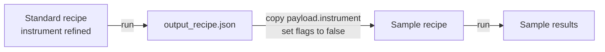

# Calibrate the instrument with a standard

**Goal:** measure your instrument's contribution to the pattern once, on a
standard, and reuse it for every sample measured the same way. That
contribution is its peak shape and whichever corrections apply to your
geometry. Holding the instrument fixed means the sample refinement fits only
the sample: its peak broadening, cell and structure.

**You need:**
- A pattern of a standard (LaB6, Si, CeO2) measured at the **same wavelength
  and geometry** as your samples.
- A recipe for your sample, written for the **same engine** you will use for
  the standard. With easydiffraction, it must also use the same calculator.
- The engine's environment ([Install](../getting-started/install.md)).



## 1. Refine the standard

Start from the LaB6 example for your engine. Copy it into a folder of your
own, for example `my_lab6/`.

::::{tab-set}
:sync-group: engine

:::{tab-item} GSAS-II
:sync: gsasii
`examples/example_LaB6/input.json`
:::
:::{tab-item} TOPAS
:sync: topas
`examples/example_LaB6/topas/input.json`
:::
:::{tab-item} easydiffraction
:sync: easydiffraction
`examples/example_LaB6/easydiffraction/input.json`

This example refines the cell. For a calibration, set the flags of `a`, `b`
and `c` to `false`.
:::
::::

Put your pattern into the recipe's `xrd_data` block. Set the cell to your
standard's certified value, held (`false`).

Refine the scale, the background, the peak-shape parameters and the
corrections that matter for your instrument. Which corrections those are
depends on the geometry and the engine. See the instrument section of your
engine's page: [GSAS-II](../engines/gsasii.md),
[TOPAS](../engines/topas.md) or
[easydiffraction](../engines/easydiffraction.md).

Then run it:

::::{tab-set}
:sync-group: engine

:::{tab-item} GSAS-II
:sync: gsasii
```bash
pixi run -e gsasii powderline my_lab6/input.json
```
:::
:::{tab-item} TOPAS
:sync: topas
```bash
pixi run powderline my_lab6/input.json --topas-version 6 --topas-dir C:/TOPAS6
```
TOPAS runs on Windows only. See [Run TOPAS recipes](run-topas.md).
:::
:::{tab-item} easydiffraction
:sync: easydiffraction
```bash
pixi run -e easydiffraction powderline my_lab6/input.json
```
:::
::::

Check the fit before going on. Plot `y_obs`, `y_calc` and `y_diff` from
`my_lab6/output/fit_profile.txt` and look at the difference curve, not just
Rwp. A poor calibrant fit gives a wrong instrument for every sample.
[Good refinement practice](../concepts/refinement-practice.md) has more on
judging a fit.

## 2. Copy the refined instrument

Open `my_lab6/output/output_recipe.json`. It is your recipe with the refined
values written back. Copy its whole `payload.instrument` block into your
sample recipe, replacing the one there.

:::{note}
If the run reported `output_recipe_valid: false`, the engine returned a value
the recipe format refuses. Read the `output_recipe_not_valid` warning and fix
the standard's refinement before you copy anything.
:::

## 3. Hold the instrument

Set every refine flag in the copied block to `false`. The sample refinement
should fit the sample, not re-fit the instrument.

Change only the flags. For each parameter, the value stays and the flag
becomes `false`:

```text
"U": [49.11908, true]    becomes    "U": [49.11908, false]
```

Do this for every flag in `payload.instrument`:

::::{tab-set}
:sync-group: engine

:::{tab-item} GSAS-II
:sync: gsasii

`radiation.wavelength`, the three `corrections` (`zero_shift`,
`polarization`, `axial_divergence`) and the six `broadening` terms `U`, `V`,
`W`, `X`, `Y`, `Z`. Values are `[value, flag]`.
:::

:::{tab-item} TOPAS
:sync: topas

Every parameter in `radiation`, `corrections` and `broadening.parameters`.
Values are `[value, flag, min, max]`; leave the bounds as they are.
:::

:::{tab-item} easydiffraction
:sync: easydiffraction

Every parameter in `radiation`, `corrections` and `broadening.parameters`.
Values are `[value, flag, min, max]`; leave the bounds as they are. The peak
types depend on the calculator, so the block validates only in a sample
recipe with the same `refinement_controls.calculator` as the standard's.
:::
::::

The `hold()` function under [In Python](#in-python) does this for you.

:::{caution}
Check that the refined values are physical before you hold them. For
example, a negative Lorentzian term can make the peak width negative at
high angle. A held value carries its problem into every sample refinement.
See [Good refinement practice](../concepts/refinement-practice.md).
:::

## 4. Validate and run the sample

```bash
pixi run powderline my_sample/input.json --validate-only
pixi run -e gsasii powderline my_sample/input.json
```

Use the run command for your engine, as in step 1.

**Check:** open `my_sample/output/parameter_dispositions.csv`. Every row whose
`path` starts with `payload.instrument` reads `held_by_user`.

:::{warning}
An instrument block belongs to one engine. GSAS-II's `U, V, W` are in
centidegrees², TOPAS's and easydiffraction's in degrees², and `X` and `Y`
swap roles. To use a GSAS-II calibration with TOPAS, refine the standard
again with TOPAS.
:::

## In Python

The same steps as a script. `hold()` sets every refine flag in a block to
`False` and leaves everything else as it is.

```python
from pathlib import Path
import powderline

cal = powderline.run(powderline.load_recipe_asset(Path("my_lab6/input.json")),
                     Path("my_lab6/output"))
if not cal["output_recipe_valid"]:
    raise SystemExit("the standard's output recipe is not valid: check its warnings")

def hold(block):
    """Return a copy of the block with every refine flag set to False."""
    if isinstance(block, dict):
        return {k: hold(v) for k, v in block.items()}
    if isinstance(block, list) and len(block) >= 2 and isinstance(block[1], bool):
        return [block[0], False, *block[2:]]
    return block

sample = powderline.load_recipe_asset(Path("my_sample/input.json"))
sample["payload"]["instrument"] = hold(cal["output_recipe"]["payload"]["instrument"])
result = powderline.run(sample, Path("my_sample/output"))
print(result["rwp"])
```

Run it in the engine's environment, for example
`pixi run -e gsasii python calibrate.py`.

**Next:** [Refine a structure](refine-structure.md), or
[Run a series](sequential-refinement.md) to refine many patterns from one
sample recipe.
