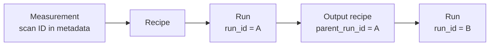

# Use PowderLine from Python and in pipelines

**Goal:** check and run recipes from your own code: a notebook, a beamline
pipeline, a web service, a recipe builder or an agent. Results come back as
Python objects, failures as exceptions you can catch, and your metadata
travels with the analysis.

**You need:**
- A local clone of PowderLine.
- [pixi](https://pixi.sh) for your own project.
- For runs, the engine your recipes name.

A recipe is structured data: in Python, a `dict`. It can come from a file, a
database record, a message on a queue or a live data stream. PowderLine
never needs it on disk.

## 1. Add PowderLine to your project

PowderLine is not on PyPI or conda-forge. You add it to your project as an
**editable install** of a local clone. Changes to the clone's source are
picked up without reinstalling.

Two `pixi.toml` templates in `docs/integration/` match PowderLine's own
environments:

| Template | What it installs | Use it for |
|---|---|---|
| `pixi_schema_only.toml` | PowderLine and its own dependencies, no engine | building, editing or checking recipes; CI pre-flight checks |
| `pixi_full.toml` | the same, plus GSAS-II | running `gsasii.*` recipes |

1. Copy the template into your project as `pixi.toml`:

   ```bash
   cp /path/to/PowderLine/docs/integration/pixi_schema_only.toml /path/to/your-project/pixi.toml
   ```

2. Set your project's name in `[workspace]` and the path to your clone in
   `[pypi-dependencies]`:

   ```toml
   [workspace]
   name = "your-project-name"

   [pypi-dependencies]
   powderline = { path = "/path/to/PowderLine", editable = true }
   ```

3. Install and check:

   ```bash
   cd /path/to/your-project
   pixi install
   pixi run python -c "import powderline; print(powderline.support_matrix())"
   ```

**Check:** the matrix lists three gateways, `easydiffraction`, `gsasii` and
`topas`, each with the schema versions it accepts.

### Engines in your project

- **GSAS-II** is not on PyPI or conda-forge either. `pixi_full.toml`
  declares it as a package built by pixi from the `tacaswell/GSAS-II` fork,
  pinned to the same commit as PowderLine's own `pixi.toml`. Keep that pin:
  the gateway checks for GSAS-II 5.7.9 at run time and refuses another
  version.
- **easydiffraction**: add what PowderLine's `easydiffraction` feature
  declares: Python 3.12 or later, `easydiffraction ==0.21.1` from PyPI and
  `diffpy.pdffit2` from conda-forge.
- **TOPAS** has no Python package. See [Run TOPAS recipes](run-topas.md).

`import powderline` imports no engine. An engine is imported only when a
recipe of that engine runs.

## 2. Validate a recipe

Validation needs no engine. It works for every engine's recipes in the
validation-only environment.

```python
import json
from pydantic import ValidationError
import powderline

recipe = json.loads(text)          # from a file, a database record, a message ...

try:
    checked = powderline.validate(recipe)
except ValidationError as exc:
    for error in exc.errors():
        print(".".join(str(p) for p in error["loc"]), "|", error["msg"])
else:
    for w in checked.warnings:     # {code, message, field_path[, level]}
        print(w["code"], w["field_path"])
```

Every problem is listed at once, each at its field, most with the value to
write:

```
payload.instrument.radiaton | Extra inputs are not permitted
payload.phases.LaB6.unit_cell | Value error, unit cell is inconsistent with 'P m -3 m' (cubic): stated b = 4.2, but by symmetry b = a; write b = 4.15682
```

A valid recipe can still carry warnings: a default applied, or a value held
in its exact symmetry form. `checked.recipe` is the validated model.
[Messages](../reference/messages.md) lists every warning code.

To read a recipe saved on disk, `powderline.load_recipe_asset(path)` returns
the dict without interpreting it.

## 3. Run a recipe

```python
from pathlib import Path

result = powderline.run(recipe, Path("output/run_0001"))
print(result["status"], result["rwp"], result["converged"])
cell = result["unit_cell_data"]["LaB6"]          # a pandas DataFrame
```

`run()` validates the recipe, hands it to the engine its `schema_name`
names, writes the report files into the output directory and returns a
dict. Tables are pandas DataFrames. Per-phase tables are dicts keyed by
phase name. Every engine returns the same keys; see
[Outputs](../reference/outputs.md).

`powderline.run(recipe, output_dir, validate_only=True)` validates and
returns a short summary, without an engine and without writing anything.

### Engine options

Engine options are keyword arguments. An option the recipe's engine does
not take is a `TypeError`.

| Engine | Option | Meaning |
|---|---|---|
| GSAS-II | `execution_mode` | `"auto"` (default), `"server"` or `"subprocess"`; see [Run at a beamline](beamline-operation.md) |
| GSAS-II | `server_timeout` | seconds to wait for the GSAS-II server's answer; default no limit |
| TOPAS | `topas_dir` | the folder holding `tc.exe` |
| TOPAS | `topas_version` | the installed TOPAS version, `"6"` |
| TOPAS | `topas_timeout` | seconds per `tc.exe` run; default 3600, 0 for no limit |
| easydiffraction | none | |

```python
result = powderline.run(topas_recipe, Path("out"), topas_version="6", topas_dir=Path(r"C:\TOPAS6"))
```

## 4. Handle failures

A failed run never returns a result. It raises one of two errors:

| Error | Meaning | Example `.reason` |
|---|---|---|
| `EngineExecutionError` | the engine ran and failed | `diverged`, `unusable_site`, `engine_crashed` |
| `ExecutionBackendError` | the engine never ran | `server_unavailable`, `timeout` |

```python
try:
    result = powderline.run(recipe, out)
except powderline.EngineExecutionError as e:
    print("refinement failed:", e.reason, e.result["output_files"])
except powderline.ExecutionBackendError as e:
    print("could not run the engine:", e.reason)
```

- `.reason` is a short code. [Messages](../reference/messages.md) lists
  them all.
- `.result` is the full failure record. `.result["failure"]` holds the
  `kind`, `reason`, `message` and `traceback`. For GSAS-II it also holds
  `console_tail`, the last of what GSAS-II printed.
- The same record is written to `failure.json` in the output directory,
  next to whatever the engine wrote. No result table is written for a
  failed run.

Other errors come before anything runs:

- An invalid recipe raises pydantic's `ValidationError`.
- A recipe whose engine is not installed here raises
  `EngineNotAvailableError`, naming the environment to use.
- An installed engine of the wrong version raises `EngineVersionError`.

An invalid recipe or a missing engine leaves the output directory as it
was, with any earlier results in place. All PowderLine errors derive from
`powderline.PowderLineError`. pydantic's `ValidationError` is a
`ValueError`.

## Carry metadata and provenance through

A recipe may carry a free-form `metadata` block: a sample ID, a scan ID, the
data's place in your catalogue, how the recipe was made.

```python
recipe["metadata"] = {"sample_id": "S-0421", "scan_id": "70c707"}
```

PowderLine never reads it. It must be JSON-serialisable and at most 1 MiB as
JSON. The output recipe keeps it unchanged and adds one key,
`powderline_provenance`:

```python
result["output_recipe"]["metadata"]
# {'sample_id': 'S-0421', 'scan_id': '70c707',
#  'powderline_provenance': {'parent_run_id': '…', 'schema_name': 'gsasii.rietveld',
#                            'engine': 'gsasii', 'engine_version': '5.7.9',
#                            'powderline_version': '0.2.0', 'created': '2026-…'}}
```

| Field | Meaning |
|---|---|
| `parent_run_id` | the `run_id` of the run that produced this recipe; `None` in a validate-only summary |
| `schema_name`, `engine` | the recipe's workflow and engine |
| `engine_version` | the engine version the run used (TOPAS: the declared one); `None` in a validate-only summary |
| `powderline_version` | the PowderLine version that ran |
| `created` | when, in UTC |

Every result has its own `run_id`. A `failure.json` carries a
`powderline_provenance` block too, with `schema_name`, `engine`,
`engine_version`, `powderline_version`, `created` and `run_id`. Store the
`run_id` with your results and a chain of analyses leads back to the data
and the recipe that started it.



[Results](../concepts/results.md) explains the output recipe and its
dispositions.

## Example scripts

Both scripts work as they are from a PowderLine clone:

- `docs/integration/example_schema_only.py` validates one recipe, then every
  committed example recipe of every engine, with no engine installed:

  ```bash
  pixi run python docs/integration/example_schema_only.py
  ```

- `docs/integration/example_full.py` validates the LaB6 example, runs it
  with `powderline.run()`, then runs it again through the GSAS-II server
  client, `GSASClient`:

  ```bash
  pixi run -e gsasii python docs/integration/example_full.py
  ```

If you copy a script elsewhere, edit its `POWDERLINE_REPO` constant.

:::{note}
The gateways are found through install-time entry points. If
`support_matrix()` comes back empty, or `pixi run powderline --doctor`
reports no gateway, see {ref}`KI-13 <ki-13>`.
:::

**Next:** [Run a series](sequential-refinement.md),
[Run at a beamline](beamline-operation.md),
[Python API](../reference/api.md).
