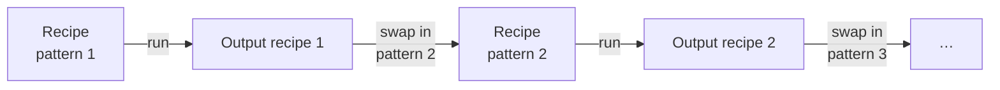

# Run a series

**Goal:** refine a series of patterns of one sample (a temperature ramp, a
time series, an in situ experiment) in sequence. Each step starts from the
refined values of the step before, and only the data change.

**You need:**
- A recipe that refines the first pattern well. Calibrate the instrument
  first ([Calibrate the instrument](calibrate-instrument.md)).
- Each further pattern as an `xrd_data` block: `tth`, `Itth`,
  `Itth_weights` and, optionally, `filename`. Your own reader builds these
  blocks from your data files, a database or a live stream.
- Python, in the engine's environment.

Every result carries an **output recipe**: your recipe with the refined
values written back. It is a complete recipe of the same engine, ready to
run again. A series is therefore a loop over data, not over parameter names:



## 1. Write the loop

```python
from pathlib import Path
import powderline
from powderline.recipes import with_block

recipe = powderline.load_recipe_asset(Path("series/input.json"))
for i, xrd_data in enumerate(patterns):          # your xrd_data blocks, in order
    recipe = with_block(recipe, "payload.xrd_data", xrd_data)
    result = powderline.run(recipe, Path(f"series/step_{i:03d}"))
    print(i, result["rwp"], result["converged"])
    if not result["output_recipe_valid"]:
        for w in result["warnings"]:
            if w["code"] == "output_recipe_not_valid":
                print(w["message"])
        break
    recipe = result["output_recipe"]             # the next step starts here
```

- `with_block` returns a copy of the recipe with one block replaced. It does
  not change the recipe you pass in.
- Each step writes into its own output directory.
- The loop never looks at the engine. The same code runs a `gsasii.*`,
  `topas.*` or `easydiffraction.*` series.

## 2. Stop on an output recipe that is not valid

`result["output_recipe_valid"]` says whether the output recipe validates as
written. It is `False` when the engine returned a value the recipe format
refuses, for example:

- an occupancy above 1, or a negative size or `Uiso`;
- a profile that makes a peak width negative
  ({ref}`EB-87 <eb-87>`, easydiffraction);
- a split atom that refined to within 2e-3 of its special position
  ({ref}`KI-18 <ki-18>`).

The `output_recipe_not_valid` warning names each offending value. The
output recipe is still returned and written, so you can see what the engine
produced. Feeding it to the next step would fail validation. Stop, look at
the step, and decide: hold the parameter, or restart from a better model.

## 3. Read what each step did

`result["parameter_dispositions"]`, also written as
`parameter_dispositions.csv`, has one row per refinable value: its recipe
`path`, `value`, `esd`, `disposition` and `at_limit`. The disposition is one
of:

| Disposition | Meaning |
|---|---|
| `varied` | the engine refined it |
| `held_by_user` | its flag is `false` |
| `held_by_symmetry` | the space group fixes it |
| `requested_not_varied` | its flag is `true`, but the engine did not vary it |
| `default_applied` | the recipe left it out and a documented default was applied |

`at_limit` marks a value that ended on a stated bound or an engine limit.

To follow one value through the series, read it by path at each step:

```python
disp = result["parameter_dispositions"].set_index("path")
uiso_la = disp.loc["payload.phases.LaB6.atoms.La.Uiso", "value"]
```

The refined cell is also in `result["unit_cell_data"][phase]`, with rows
`cell_a` … `cell_gamma` and `cell_volume`.

## 4. Move only shared blocks between recipes

`with_block`, and `block` to read a copy, move only the blocks every engine
shares:

- `payload.xrd_data`
- `payload.fit_range`
- `payload.phases.<name>`

Any other path raises `ValueError`. An engine's own blocks (instrument,
background, controls) are written in that engine's terms, so they never move
between engines. To change one of them within a series, edit the recipe dict
directly.

## Try the example

`examples/example_LaB6_temperature_series/` is this loop, complete. Six
simulated LaB6 patterns from 25 to 500 °C, with a known thermal expansion
and Poisson noise, are refined in sequence by `run_series.py`:

```bash
pixi run -e gsasii python examples/example_LaB6_temperature_series/run_series.py --output my_series
```

The same runner drives the easydiffraction leg:

```bash
pixi run -e easydiffraction python examples/example_LaB6_temperature_series/run_series.py --recipe examples/example_LaB6_temperature_series/easydiffraction/input.json --output my_series_ed
```

Without `--output`, the runner writes into the example's own `output/`
folder, over the committed reference. With GSAS-II it runs in-process; add
`--use-server` to use the GSAS-II server.

**Check:** `my_series/series_report.csv` has one row per temperature, with
`output_recipe_valid` true at every step. In the committed GSAS-II
reference, every refined cell lies within 1.5 ESD of the programmed value.

## Provenance across the chain

The output recipe keeps your `metadata` block and adds
`metadata.powderline_provenance`. Its `parent_run_id` is the `run_id` of the
run that produced it. Each step's output recipe therefore names the step it
came from. [Use PowderLine from Python](python-pipelines.md#carry-metadata-and-provenance-through)
lists every provenance field.

**Next:** [Run at a beamline](beamline-operation.md) to run series
unattended.
