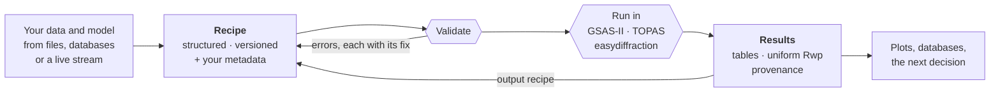

# PowderLine

**PowderLine turns a complete powder diffraction refinement into structured
data: a *recipe* that people, scripts and machines can write, check, run
and chain.**

Rietveld refinement is powerful, but reliable results take expertise in a
particular program. Running it at scale has usually meant custom code for
each project. PowderLine gives every refinement the same kind of validated,
machine-writable description: a recipe, written for one engine in that
engine's own terms. The same analysis can then be run from a GUI, a
notebook, a beamline pipeline, an autonomous experiment or an LLM agent, and
it gives the same result.

PowderLine handles constant-wavelength X-ray powder data on a 2θ axis.
[Scope and limitations](reference/scope.md) lists what it does not do.

## The idea in one picture



- **The recipe** holds the data, the structural model, the instrument, the
  refine flags and any metadata you attach. It is a dictionary in Python
  and JSON when stored or sent.
- **Validation** checks the recipe against a versioned schema and against the
  crystallography before anything runs. It needs no engine installed.
- **The engines** do the refinement. PowderLine drives them; it does not
  replace them.
- **The results** are the same structured tables for every engine, with
  provenance linking them to the recipe and your metadata. They include an
  *output recipe*, ready to be the next step's input.

→ [How PowderLine works](concepts/how-powderline-works.md) explains each step.
The [preprint](https://doi.org/10.48550/arXiv.2608.17009) gives the full
motivation.

## Where to start

::::{grid} 2

:::{grid-item-card} 🔬 I refine powder data
Run a complete refinement in a few minutes, then write a recipe for your own
data.

[Get started →](getting-started/index.md)
:::
:::{grid-item-card} 🛰️ I run a beamline
Calibrate once, refine every sample, chain a series, and run unattended.

[Calibrate the instrument →](how-to/calibrate-instrument.md) ·
[Run a series →](how-to/sequential-refinement.md) ·
[Run at a beamline →](how-to/beamline-operation.md)
:::
:::{grid-item-card} 🧩 I build pipelines and automation
Call PowderLine from Python, validate recipes without an engine, handle
failures, and carry metadata through.

[Use PowderLine from Python →](how-to/python-pipelines.md)
:::
:::{grid-item-card} ⚙️ I develop a refinement engine
What PowderLine does with each engine, every behaviour it found, and how
the engines compare on the same data.

[Engines →](engines/index.md) · [Comparing engines →](concepts/comparing-engines.md)
:::
:::{grid-item-card} 📚 I want worked examples
Real and teaching cases, with their recipes and results.

[Examples →](examples/index.md)
:::
:::{grid-item-card} 🛠️ I want to contribute
How the code is organised, how to test it, and how to add an engine.

[Development →](development/index.md)
:::
::::

## What PowderLine is (and isn't)

| PowderLine **is** | PowderLine **is not** |
|---|---|
| One validated, machine-writable description of a refinement | A new refinement algorithm: the engines do the maths |
| A strict checker of form and symmetry | A judge of your refinement choices: see [Good refinement practice](concepts/refinement-practice.md) |
| One interface and one result format for three engines | A translator: a GSAS-II recipe stays a GSAS-II recipe |
| A component you plug into larger workflows | A CIF reader or recipe builder: your tools write the recipe |

```{toctree}
:hidden:
:maxdepth: 2

getting-started/index
concepts/index
how-to/index
examples/index
engines/index
reference/index
development/index
about/index
```
