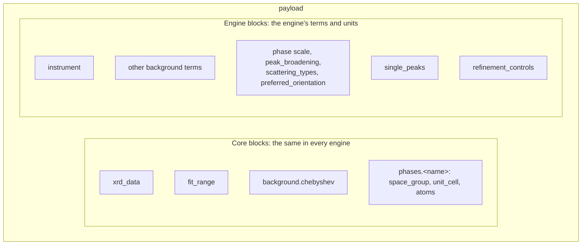

# Recipe format

A recipe is structured data: a dictionary in Python, serialised as JSON when
it is stored or sent. This page gives the rules every recipe follows,
whatever its engine. Every individual field, with its unit, is on
[Fields](fields.md).

## The frame

Every recipe has four required top-level keys (`schema_name`,
`core_schema_version`, `engine_schema_version`, `payload`) and an optional
`metadata`. A `topas.*` recipe adds a required `engine_version`.

```json
{
  "schema_name": "gsasii.rietveld",
  "core_schema_version": "0.1.0",
  "engine_schema_version": "0.1.0",
  "metadata": {"sample_id": "LaB6-660c", "scan_id": 4711},
  "payload": {"xrd_data": {}, "instrument": {}, "phases": {}, "refinement_controls": {}}
}
```

| Key | Required | Value |
|---|---|---|
| `schema_name` | yes | `<engine>.<workflow>`: one of the five names below. It selects the engine that runs the recipe. |
| `core_schema_version` | yes | The core schema version the recipe is written against: `"0.1.0"`. |
| `engine_schema_version` | yes | The engine schema version the recipe is written against: `"0.1.0"` for every engine. |
| `metadata` | no | Free-form, JSON-serialisable data. At most 1 MiB as UTF-8 JSON. PowderLine never reads it and carries it into the [output recipe](outputs.md#the-output-recipe). |
| `payload` | yes | The refinement itself, written in the engine's own terms. |
| `engine_version` | `topas.*` only | The TOPAS release the recipe is written for: `"6"`. |

The five schema names:

| `schema_name` | Engine | Workflow |
|---|---|---|
| `gsasii.rietveld` | GSAS-II | Rietveld refinement, one or more phases |
| `gsasii.spf` | GSAS-II | Single-peak fitting, no phases |
| `topas.rietveld` | TOPAS | Rietveld refinement, one or more phases |
| `topas.spf` | TOPAS | Single-peak fitting, no phases |
| `easydiffraction.rietveld` | easydiffraction | Rietveld refinement, one or more phases |

Which versions a release accepts is on
[Versions and compatibility](versions.md). Which features each schema offers
is on the [Engines overview](../engines/index.md).

:::{note}
The data arrays are inside the recipe. A recipe never points at a data file,
so it means the same thing wherever it is sent.
:::

## Core blocks and engine blocks



- **Core blocks** are defined once and checked once, in the same way for every
  engine. A structure written for one engine means the same in another.
- **Engine blocks** hold the instrument, the background terms beyond
  Chebyshev, the phase's own engine fields and the controls. They use the
  engine's names and units. They are never translated between engines.

### Move a structure between engines

Only the core blocks move between recipes of different engines:
`payload.xrd_data`, `payload.fit_range` and a whole `payload.phases.<name>`
block. Within a phase, the parts that carry over are these:

| Carries over unchanged | Rewrite for the target engine |
|---|---|
| `space_group`, `unit_cell`, `atoms` (the structure) | The parameter shape: `[value, flag]` in `gsasii.*`, `[value, flag, min, max]` in `topas.*` and `easydiffraction.*` |
| | The engine's own phase fields: `scale`, `peak_broadening`, `scattering_types`, `preferred_orientation` |

The helpers `powderline.recipes.block` and `powderline.recipes.with_block`
copy a core block (see [Python API](api.md#recipe-helpers)). `with_block`
copies the whole phase block, engine fields included, and does not validate
the result. The target recipe's schema then validates it: a parameter of the
other engine's shape, or an ion the target engine has no form factor for, is
an error there.

### Phase and histogram parameters

- **Phase parameters** belong to one crystal structure: space group, unit
  cell, atoms, scale and sample broadening. They live in `phases.<name>`.
- **Histogram parameters** belong to the measurement: the instrument profile,
  the instrument corrections and the background. They live in `instrument`
  and `background`.

In a multi-phase refinement each phase has its own phase parameters, and all
phases share the histogram parameters.

## Diffraction data

`payload.xrd_data` carries the pattern inline, as three arrays of equal
length:

| Key | Meaning | Unit |
|---|---|---|
| `tth` | 2θ of each point, strictly increasing | `degree 2theta` |
| `Itth` | Measured intensity | `arbitrary` |
| `Itth_weights` | The least-squares weight of each point, 1/σ² | `1/intensity^2` |
| `filename` | Optional free text: the file the arrays came from | — |

PowderLine never repairs data. It accepts or rejects it. Validation rejects:

- empty arrays;
- arrays of unequal length;
- any non-finite value in any array (a weight computed as 1/0² is `inf`);
- a `tth` that is not strictly increasing;
- a negative weight;
- weights that are all zero.

Sorting, de-duplicating, unit conversion and deriving weights are the job of
whatever builds the block.

| Data rule | GSAS-II | TOPAS | easydiffraction |
|---|---|---|---|
| A point with weight 0 | handed to GSAS-II with zero weight | dropped from the `.xye` file | not handed to easydiffraction |
| A negative intensity | accepted | accepted | refused when the point would be handed to the engine (give it weight 0) |
| A weight above 1e8 (σ < 1e-4) | accepted | accepted | refused: easydiffraction would replace σ by 1.0 without saying so; rescale intensities and weights together |

A point with weight 0 is never counted in the
[uniform statistics](../concepts/results.md). Use weight 0 to mask a detector
gap or an impurity peak, rather than deleting the points.

## The fit window

`payload.fit_range` is `[min, max]` in degrees 2θ.

- Either end may be `null`, an open end: the window then runs to the data's
  first or last point with a positive weight. Left out, the window is the
  data's first to last weighted point.
- Both stated ends lie inside the data's 2θ span.
- `max` is greater than `min`.
- The window holds at least two points with a positive weight.
- PowderLine moves each limit onto a data point before it hands it to the
  engine: `min` to the first weighted point with 2θ ≥ `min`, `max` to the
  last weighted point with 2θ ≤ `max`. Every engine then fits the same
  points, and the statistics count the same points.
- Background peaks and single peaks lie inside the window.

## Parameters

A refinable quantity is a JSON list, never an object. Its shape is set by the
engine:

| Engines | Shape | Example |
|---|---|---|
| `gsasii.*` | `[value, refine_flag]` | `"wavelength": [0.1665, false]` |
| `topas.*`, `easydiffraction.*` | `[value, refine_flag, min, max]` | `"a": [4.157, true, 4.1, 4.2]` |

- `value` is a finite number. It is never `null`.
- `refine_flag` is a JSON boolean: `true` refines the value, `false` holds it.
  `1`, `0` and `"true"` are errors.
- `min` and `max` are numbers, or `null` for an open side. When both are
  stated, `min` ≤ `max`, and `value` lies between them.
- Within one engine every parameter has that engine's shape. A list of the
  other length is an error, never truncated or padded.

```json
"scale": [1.0, true, null, null]
```

This TOPAS or easydiffraction parameter is refined with no bound of its own on
either side. The engine's own limit still applies on each `null` side: see
[Bounds](#bounds).

Parameters tied by symmetry are one parameter. Every member is stated, with
the same flag. A parameter fixed by symmetry has flag `false` and no bounds.
The rules are on [Validation](../concepts/validation.md).

## Bounds

A bound means something different in each engine. Each schema exposes what its
engine does.

| | GSAS-II | TOPAS | easydiffraction |
|---|---|---|---|
| Parameter shape | `[value, flag]`: no bounds | `[value, flag, min, max]` | `[value, flag, min, max]` |
| A stated `min` or `max` | not accepted | replaces TOPAS's default limit on that side | replaces the physical limit on that side |
| A `null` side | — | keeps TOPAS's default limit | keeps the physical limit |
| A value outside the engine's limit | — | refused when refined from outside a fixed default limit on a `null` side | refused, even when the parameter is fixed |
| A refined value that ends at a limit | — | warning `topas_parameter_at_limit` | warning `easydiffraction_parameter_at_limit` |

### Bounds that symmetry constrains

These rules hold in every engine with bounds.

- **Cell bounds** lie in the cell's own range: a length's `min` is greater
  than 0, and an angle's `min` and `max` lie strictly between 0 and 180.
  `null` means no bound.
- **A parameter fixed by symmetry** has no bounds: `min` and `max` are
  `null`.
- **Tied members' bounds follow the tie**, as their values do. For a member
  `y = k·x + c` of a tie group whose first member is `x`, x's `[min, max]`
  maps to y's `[k·min + c, k·max + c]`. The two are swapped for negative `k`.
  An open side stays open, on the matching side.
- A tied member's bounds are stated within the tolerance of their kind:
  5e-6 for coordinates, 1e-6 Ų for Uij, 1e-9 (relative) for cell lengths
  and 1e-9° for cell angles. They are then read as the mapped values.
  Otherwise the error gives the values to write.

For example, at (x, x + 1/2, z) with x bounded `[0, 0.2]`, y must be bounded
`[0.5, 0.7]`. At (x, −x + 1/2, z), y must be bounded `[0.3, 0.5]`.

### GSAS-II: no bounds

A `gsasii.*` parameter is `[value, refine_flag]`. A four-entry list is a
validation error.

GSAS-II applies limits only after all cycles of a refinement call. A value
outside its limit is then set to the limit, with ESD 0, and frozen for the
next call. The values, ESDs and Rwp reported for that call still belong to the
unclamped fit ({ref}`EB-30 <eb-30>`). Cell limits must also be set on the
reciprocal-metric terms, which map exactly onto direct-cell limits for only
four of the seven crystal systems ({ref}`EB-31 <eb-31>`). A recipe bound
could therefore not mean what it says, so the GSAS-II schema has none.

### TOPAS: default limits

TOPAS keywords carry default limits, and the TOPAS.INC macros add their own to
refined parameters. Some examples:

| Parameter | TOPAS default limit |
|---|---|
| `scale` | ≥ 1e-11 |
| `beq` (written from `Uiso`) | −10 to 20 |
| cell lengths | ≥ 1.5 Å |
| March–Dollase `PO` ratio | min 0.0001, max 2r + 0.5 |

- A stated bound replaces TOPAS's limit on that side. A `null` side keeps
  TOPAS's limit.
- TOPAS would silently move a start outside a limit onto the limit
  ({ref}`EB-58 <eb-58>`). A refined start outside a fixed default limit on a
  `null` side is therefore a validation error. State a bound to override
  TOPAS, or start inside its limit.
- TOPAS 6 stops a little past a bound, not exactly on it. After a run, every
  refined value within 1e-4 (relative) of a stated bound or a default limit
  gets `topas_parameter_at_limit`. At a limit of 0 the tolerance is 1e-12.
  A single-peak position counts as at the fit window's edge when no data
  point lies between it and the edge.
- PowderLine judges this from the final values and the limits it wrote. It
  does not use the limit markers TOPAS writes, which can be wrong
  ({ref}`EB-62 <eb-62>`).

### easydiffraction: physical limits

easydiffraction gives every unbounded side of a refined parameter its
physical limit ({ref}`EB-71 <eb-71>`):

| Parameter | Physical limit |
|---|---|
| cell lengths | 0 to 30 Å |
| cell angles | 0 to 180° |
| `occupancy` | 0 to 1 |
| `Uiso`, `U11`, `U22`, `U33` | 0 to 10 Ų |
| `scale`, wavelength, `mu_r` | ≥ 0 |

- A stated bound replaces the physical limit on that side. A `null` side
  keeps it.
- easydiffraction refuses a value outside a physical limit, even a fixed one.
  Such a value is a validation error. A cell length over 30 Å cannot be
  modelled.
- lmfit would silently move a start outside its bounds onto the bound. The
  rule that a value lies between its stated bounds prevents this.
- A refined value that ends within 1e-6 (relative) of a bound or physical
  limit gets `easydiffraction_parameter_at_limit`. For a limit of 0 the
  tolerance is relative to the parameter's starting value.

## Numbers, booleans and `null`

- **Numbers are JSON numbers.** A quoted number (`"0.25"`) or a boolean where
  a number belongs is an error. Nothing is converted.
- **Integer fields** (for example `num_coefficients`, `Multiplicity`, `bank`,
  `refinement_cycles`, `iters`, `max_iterations`) take a whole number: `4` or
  `4.0`, not `4.5`.
- **Non-finite numbers** (NaN, infinity) are errors.
- **`null` appears only where a field allows it**: an open side of a bound,
  or an open end of `fit_range`.
- **A block that may be left out is left out, never `null`.** Write no key
  rather than `"peak_broadening": null`.

## Unknown keys

Every key not in the schema is an error, at every level. A misspelt key is
reported, never ignored:

```text
payload -> instrument -> radiaton: Extra inputs are not permitted
```

## What "left out" means

The *Notes* column of each [field table](fields.md) says what an optional
field means when it is left out.

- In `gsasii.*` a few blocks have documented defaults: sample broadening
  10 µm and 0 microstrain, no background, and 5 refinement cycles. Each
  default comes with a [warning](messages.md#warning-codes).
- In `topas.*` and `easydiffraction.*` nothing has a default. A block left
  out is not modelled.

## Names

Phase names (the keys of `phases`) and atom labels (the keys of `atoms`):

- start with an ASCII letter and contain only ASCII letters, digits and `_`;
- are at most 64 characters long;
- are not Python keywords (`None`, `class`, …);
- differ by more than case: two phases, or two atoms of one phase, may not be
  `O1` and `o1`.

This is the one form every engine accepts as it is. Phase names also become
report file names, and file names ignore case on Windows and macOS. Write
`"2H-MoS2"` as `MoS2_2H`, for example.

## Units

Units are fixed per field (the *Unit* column of the field tables). A recipe
never states a unit. Each recipe states the engine's own numbers, so the same
quantity can have different units in different engines. GSAS-II's `U` is in
centidegree², easydiffraction's `broad_gauss_u` in degree².

| Unit | Meaning | Used in |
|---|---|---|
| `degree 2theta` | degrees on the 2θ axis | every schema |
| `degree` | degrees (angles, not 2θ) | every schema |
| `angstrom` | Å | every schema |
| `angstrom^2` | Ų (`Uiso`, `Uij`) | every schema |
| `arbitrary` | intensity units (counts, normalised) | every schema |
| `1/intensity^2` | weight, 1/σ² | every schema |
| `dimensionless` | a pure number | every schema |
| `centidegree 2theta` | 0.01° on the 2θ axis | `gsasii.*` |
| `centidegree^2 2theta` | (0.01°)² on the 2θ axis | `gsasii.*` |
| `micrometre` | µm (crystallite size) | `gsasii.*` |
| `microstrain` | 10⁻⁶ | `gsasii.*` |
| `milliangstrom` | mÅ (emission-line width) | `topas.*` |
| `nanometre` | nm (crystallite size) | `topas.*` |
| `millimetre` | mm (goniometer radii, axial lengths, capillary diameter) | `topas.*` |
| `1/cm` | linear absorption coefficient | `topas.*` |
| `degree^2` | degrees² (profile terms) | `easydiffraction.*` |

TOPAS's peak-type parameters (`instrument.broadening.parameters`) are named
by the peak-type macro, so their field rows carry no unit. Their units depend
on the peak type: [TOPAS: units that differ from other
engines](../engines/topas.md#units-that-differ-from-other-engines) lists them.
